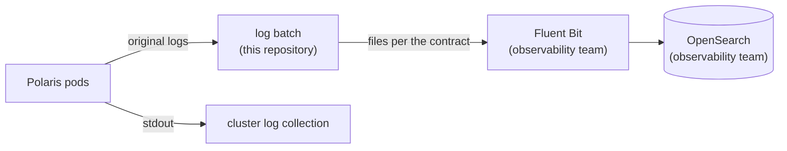

# ADR-024: The log batch hands processed files to the observability team's Fluent Bit

- **Status:** Superseded by ADR-081
- **Date:** 2026-10-10
- **Related:** ADR-013, ADR-014, ADR-023

## Context

ADR-013 had this repository run Fluent Bit and OpenSearch. Both belong to the observability
team (ADR-023). What stays here is the Polaris log batch (ADR-014): Kade's direction
(2026-10-10) is that this repository ships Polaris's original logs from its pods, processes
them, and leaves files ready for the observability team's Fluent Bit to send to OpenSearch.

## Decision

- **The hand-off is a set of files**, written by the log batch (ADR-014) to a location the
  observability team's Fluent Bit reads. The location (volume, path) is configured in `.env`;
  how it is shared is ADR-014's open question.
- **The file format is a contract**, documented in `docs/contracts/polaris-logs.md` when the
  batch enters: one JSON object per line, UTF-8, a fixed set of fields with their types, one
  file per hour, and how a file is marked complete. A change to the format is a new version of
  the contract, announced to the observability team before it ships.
- **Polaris's own logs stay on stdout as well**, so the cluster's default log collection keeps
  working whatever the batch does.
- **The gate proves the hand-off** with a stand-in Fluent Bit (ADR-023) that reads the files
  and checks each line against the contract's schema.
- **Index templates, ISM policies, Fluent Bit configuration and Lua filters are not kept
  here.** They belong to the observability team.
- **Supersedes ADR-013.**

## Diagram

## Alternatives considered

- **Keep running Fluent Bit and OpenSearch here (ADR-013):** duplicates the observability
  team's pipeline.
- **Ship raw logs only, processing done by the observability team:** moves Polaris-specific
  parsing to a team that does not own Polaris.
- **Push processed logs straight to OpenSearch:** needs OpenSearch credentials and index
  rights here, and bypasses the observability team's pipeline.

## Consequences

- The contract document and its schema enter with the batch, and the stand-in Fluent Bit
  checks them on every smoke run.
- ADR-014's open question (sharing the volume across nodes) must be decided before the batch
  is built; the observability team's Fluent Bit must be able to read the same location.
