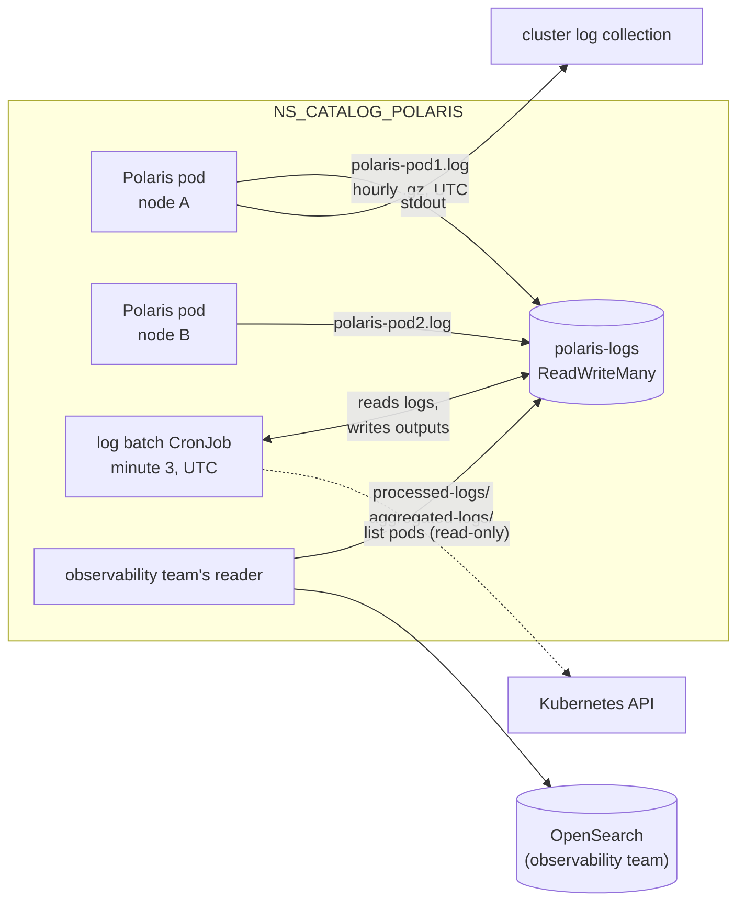

# ADR-036: Polaris and the log batch share one ReadWriteMany claim; the batch publishes each UTC hour once

- **Status:** Superseded by ADR-081
- **Date:** 2026-10-11
- **Related:** ADR-002, ADR-005, ADR-009, ADR-014, ADR-017, ADR-024, ADR-028, ADR-029, ADR-031

## Context

ADR-014 left one question open: how Polaris's log volume is shared across nodes. ADR-024 puts
the hand-off on that volume and says the observability team's Fluent Bit must read the same
location. Four facts bound the answer:

- **Polaris's pods are on different nodes.** It runs 2 replicas with required anti-affinity
  (`charts/polaris/values-lakehouse.yaml`), so a `ReadWriteOnce` volume cannot serve both.
- **A claim is namespaced.** Only pods in its own namespace can mount it.
- **Upstream's chart owns its log claim.** With `logging.file.enabled`, the 1.6.0 chart
  creates a `ReadWriteOnce` claim named after the release and removed with it
  (`charts/polaris/templates/storage.yaml`). The chart stays unchanged (ADR-009).
  It does offer `advancedConfig`, `extraVolumes` and `extraVolumeMounts`.
- **Kind can offer `ReadWriteMany`.** Kind v0.33.0 (`gates/pins.json`) ships
  local-path-provisioner v0.0.34 (kind's `images/local-path-provisioner/Makefile` at
  `v0.33.0`). That version supports `sharedFileSystemPath`, a directory mounted on every node,
  with all access modes, `ReadWriteMany` included (the provisioner's README).

The archive (`enjay27/lakehouse-k8s` at `09a4773`) holds the batch's design and code:

- `logging/PLAN-polaris-log-batch-2026-09-27.md`: lines selected by timestamp, a checkpoint
  per hour, atomic publication, orphaned files, retention.
- `images/polaris-log-batch/polaris_log_batch.py`: 40 unit tests, and its output identical to
  the Fluent Bit Lua filter's on 5 seeds of about 5,300 lines
  (`logging/scripts/step16-batch-lua-parity.py`).
- `logging/HANDOFF-polaris-log-batch-2026-09-28.md`: the batch was **never built, rendered or
  run on a cluster**. It ran on a single node, with hour windows at a fixed +09:00 offset.

These claims stay open until the gate proves them (ADR-000).

Kade's choices on 2026-10-11 (#45):

- one `ReadWriteMany` claim;
- the work in two PRs;
- UTC;
- retention and the completion marker as in the archive;
- the batch a CronJob in Polaris's namespace, its image built from this repository.

## Decision

This ADR answers ADR-014's open question and replaces nothing else in it.

### 1. One `ReadWriteMany` claim

- **The claim:** `polaris-logs`, `ReadWriteMany`, in `NS_CATALOG_POLARIS`.
  - `install/release.py` step 1 creates it before Polaris, outside any Helm release, so an
    uninstall keeps the logs.
  - Its storage class and size come from `.env` (`POLARIS_LOGS_STORAGE_CLASS`,
    `POLARIS_LOGS_SIZE`), with no default (ADR-002).
  - The install stops before Polaris if the class does not exist.
- **Who mounts it:**
  - the Polaris pods;
  - the batch's CronJob;
  - the observability team's reader, in the same namespace, reading `processed-logs/` and
    `aggregated-logs/`.
- **Deleting the claim deletes the logs.** It is a destructive command, so it needs Kade's
  approval when it runs (ADR-005).

### 2. Polaris writes one file per pod

- The chart's `logging.file.enabled` stays `false`, because its claim is `ReadWriteOnce` and
  belongs to the release. The claim is mounted with `extraVolumes` and `extraVolumeMounts`
  instead.
- The file appender is set in `advancedConfig`:
  - JSON, one object per line;
  - the file is `polaris-${HOSTNAME}.log`, one per pod (ADR-014);
  - rolled hourly to `.yyyy-MM-dd-HH.gz`;
  - not rolled when the pod starts.
- **UTC:** the container's `TZ` is set to `UTC`, so roll names and timestamps are in UTC.
- **Stdout is unchanged** (ADR-024).

### 3. The batch: its own image and chart, a CronJob in Polaris's namespace

- **Built from this repository:**
  - `images/polaris-log-batch`: Python standard library only, its base image pinned by
    digest;
  - `charts/polaris-log-batch`.
- **On the gate:** the image is built and loaded into kind, as the console's is (ADR-028).
  How a release publishes it for the target clusters is decided with the first release.
- **The CronJob:**
  - in `NS_CATALOG_POLARIS`, at minute 3 of every hour;
  - `timeZone: Etc/UTC` and `concurrencyPolicy: Forbid`;
  - a ServiceAccount whose Role may only `get` and `list` pods in that namespace.
- **The install:** `install/release.py` step 1 installs it after Polaris. A failure stops the
  install, as Polaris's does (ADR-029).

### 4. What the batch does, per UTC hour H

- **Selection by timestamp, not by file.**
  - For hour H the batch reads every pod's rolls and every current file whose mtime is at or
    after H.
  - It keeps the lines whose `timestamp` is in `[H, H+1)`.
  - Only newline-terminated lines count. An unterminated last line is ignored while its file
    has been quiet for less than 120 s; after that it is malformed.
- **When an hour is published.**
  - H is publishable from H+1 plus 60 s.
  - A run publishes every unpublished hour, oldest first, at most 72 per run.
- **Exactly once.**
  - The checkpoint is per hour.
  - An hour is written to `.tmp/`, fsynced, renamed into place, and only then checkpointed.
  - A crash means the next run redoes the hour, to identical bytes.
  - `event_id` is the SHA-1 of the raw line.
- **Malformed input.**
  - An unreadable line goes to `malformed/`, and the rest of its file is processed.
  - A `.gz` that fails to decode defers its hour while it is less than 120 s old. After that,
    the whole file moves to `malformed/files/`.
- **Housekeeping, after the checkpoint.**
  - Rolls of hours up to H move to `done/YYYYMMDD/`.
  - A current file moves only when the API no longer lists its pod **and** the file is
    complete: quiet for more than 120 s, its last line in an hour up to H.
  - If the pod list cannot be read, no current file moves that run.
- **Retention:** `done/`, the outputs and `malformed/` are deleted 3 days after publication.
- **One run at a time:** a lock file under `.state/`, as well as `Forbid`.

### 5. The hand-off on the claim (ADR-024)

```
polaris-<pod>.log[.<YYYY-MM-DD-HH>[.N].gz]   written by Polaris
processed-logs/YYYYMMDD-HH.jsonl             one event per line
aggregated-logs/YYYYMMDD-HH.jsonl            written last: the hour is complete
malformed/  done/  .tmp/  .state/            the batch's own
```

An hour is complete once its `aggregated-logs/` file exists. The observability team picks it
up within the 3 days of retention.

### 6. Two versions of the contract, both before the first release

The contract lives in `docs/contracts/polaris-logs.md`, with its JSON schema next to it.

- **v1, with the first PR:**
  - each processed line is Polaris's JSON object as written, plus `event_id` and `log_hour`;
  - the aggregated file holds one summary row: the hour, lines in, processed, malformed, lines
    per pod, the source files, and the files moved as orphans.
- **v2, with the second PR:** the archive's audit policy (which lines are kept) and its report
  rows.

No release ships v1, so moving to v2 changes nothing a release has handed over.

### 7. The gate proves it (ADR-017, ADR-031)

- **`ReadWriteMany` on kind:** a StorageClass `shared` on the local-path provisioner's
  `sharedFileSystemPath`, a host directory mounted into all three nodes. It is a stand-in and
  is never released.
- **The smoke gate:**
  - sends traffic to both Polaris replicas;
  - runs the batch with its clock set past the current hour, so the current files are
    published;
  - runs a stand-in Fluent Bit, pinned, in `NS_CATALOG_POLARIS`. It mounts the claim
    read-only and reads the outputs as the observability team's reader would.
- **`gate.py` then checks:**
  - every line read against the contract's schema;
  - every request sent appears exactly once;
  - both pods' files were read, though they were written on other nodes;
  - a second run produces identical bytes.

## Diagram



## Alternatives considered

- **A `ReadWriteOnce` volume per pod (a StatefulSet), the batch reading through the API:**
  upstream's chart has a Deployment only.
- **hostPath on each node, a batch per node, the node's Fluent Bit reading there:** needs no
  `ReadWriteMany`. But Pod Security's baseline and restricted levels refuse hostPath, and the
  output becomes one file per node instead of one per hour.
- **Upstream's own log claim:** `ReadWriteOnce`, owned by the release, and deleted with it.
- **Polaris and the batch pinned to one node with `ReadWriteOnce`** (the archive's fallback):
  contradicts 2 replicas with required anti-affinity.
- **Hour windows in a local zone** (the archive's +09:00): Kade chose UTC.
- **The whole audit policy in the first PR:** Kade chose two PRs.

## Consequences

- **Target clusters need a `ReadWriteMany` storage class.** Whether they have one is not known
  yet (#9). Without one the install stops before Polaris, and says why.
- **The observability team's reader runs in `NS_CATALOG_POLARIS`,** because a claim cannot be
  mounted from another namespace.
- **Not yet proven on the target's storage:** atomic renames and the lock file on its
  `ReadWriteMany` filesystem. `Forbid` keeps runs apart whatever the lock does. A Linux test
  cluster checks the rest.
- **The archive's code may be copied once this ADR is Accepted** (ADR-001). It moves to UTC,
  its namespace and labels are replaced, and each piece enters test first.
- **`.env.template` gains** `POLARIS_LOGS_STORAGE_CLASS` and `POLARIS_LOGS_SIZE` with the first
  PR.
