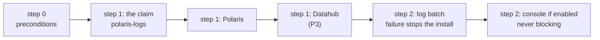

# ADR-037: The log batch installs in ADR-029's step 2, and its failure stops the install

- **Status:** Amended by ADR-081
- **Date:** 2026-10-11
- **Related:** ADR-028, ADR-029, ADR-036

## Context

ADR-029 orders a release's install:

- step 0, the preconditions;
- step 1, each service in turn, Polaris then Datahub;
- step 2, "the Polaris log batch and the console when enabled".

ADR-036, accepted on 2026-10-11, says instead that `install/release.py` step 1 installs the
batch right after Polaris. That line was written without checking ADR-029. Both ADRs are in
force, so the two rules contradict each other. ADR-036's claim, which Polaris mounts, has to
come before Polaris in step 1 either way.

Kade's choice (2026-10-11, #45): the batch stays in ADR-029's step 2.

## Decision

- **Replaces one line of ADR-036**, "`install/release.py` step 1 installs it after Polaris":
  - the batch installs in step 2, after every service of step 1 (Datahub too, once it exists)
    and before the console;
  - a batch failure stops the install, as ADR-036 says. Only the console's problems are
    printed without failing the install (ADR-028).
- **The claim stays where ADR-036 puts it:** step 1, before Polaris.
- ADR-029 is unchanged; this ADR applies its order.

## Diagram

## Alternatives considered

- **Amend ADR-029 instead, moving the batch up to step 1 right after Polaris:** a Datahub
  failure could then not hold the batch back. The cost of keeping step 2 is small: Polaris's
  files wait on the claim, and the batch catches up to 72 hours per run (ADR-036).
- **Read ADR-036's line as a typo:** a step number decides the install order, which a gate
  checks, so ADR-000 does not allow it as a typo fix.

## Consequences

- `install/release.py` installs the batch in step 2, before the console, and stops the install
  when the batch fails.
- ADR-036 becomes "Amended by ADR-037" when this ADR is accepted.
