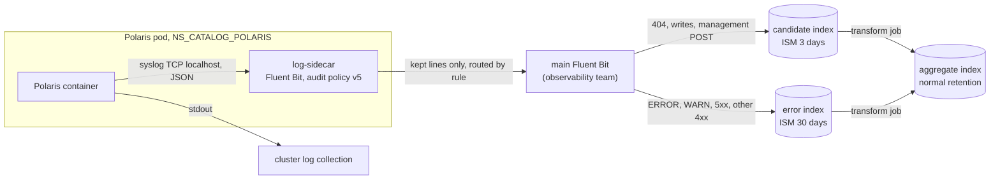

# ADR-081: Polaris logs are filtered in a sidecar into a 3-day candidate index and aggregated by an OpenSearch transform

- **Status:** Accepted
- **Date:** 2026-10-30
- **Related:** ADR-000, ADR-001, ADR-009, ADR-013, ADR-014, ADR-023, ADR-024, ADR-031, ADR-036, ADR-037, ADR-040, ADR-041, ADR-045, ADR-046, ADR-048, ADR-074

## Context

**What is in force today.**

- **ADR-024:** the hand-off to the observability team is a set of files, written by the log
  batch to a location their Fluent Bit reads, under the contract in
  `docs/contracts/polaris-logs.md`. Index templates, ISM policies, Fluent Bit configuration and
  Lua belong to that team. Polaris's stdout stays.
- **ADR-036:** one `ReadWriteMany` claim, `polaris-logs`, in Polaris's namespace. Polaris
  writes one file per pod to it (a file appender in `advancedConfig`), an hourly CronJob
  (`charts/polaris-log-batch`, `images/polaris-log-batch`) re-reads every file, and the
  observability team's reader mounts the claim. Target clusters need a `ReadWriteMany` storage
  class (`POLARIS_LOGS_STORAGE_CLASS`, `POLARIS_LOGS_SIZE` in `.env.template`); the gate has a
  `shared` class.
- **ADR-037:** the batch installs in ADR-045's step 2, and its failure stops the install.
- **Audit policy v5** (the contract, "Policy"): which lines are kept, dropped or counted. It is
  applied today by the batch.

**Why it changes.** Kade's decision on 2026-10-30 (kade-k8s-platform/tasks#2): the full log
should not leave the pod, be stored on a shared claim and be read again every hour. Only the
lines worth keeping leave the pod; what is kept is aggregated inside OpenSearch.

- Dropped-line counters are dropped.
- The candidate index keeps 3 days.
- **Error lines are kept 30 days in their own index, and only there** (Kade, 2026-10-30).
  404 access lines go to the candidate index, so that the aggregate can count them.
- The aggregate lives in a separate index.
- A transform job, not a CronJob, aggregates.

Kade's limits of 2026-10-30, from the observability team's manager:

- No log file and no PVC.
- No change to the cluster's Fluent Bit.
- No RBAC for our Fluent Bit.
- No OpenSearch credentials for us.

The cluster's Fluent Bit stores Polaris's stdout as plain text with only Kubernetes fields, so
a new index with the JSON parsed into keywords is needed. Polaris therefore sends its logs to
the sidecar over syslog on `localhost`: no file, no `emptyDir`, no claim. ADR-014's reasons for
the file stay in the archive (`enjay27/lakehouse-k8s`); nothing here reads a file or stdout.

**Facts this decision rests on** (the documentation of each product, read on 2026-10-30; none
was run for this ADR, and ADR-000 rule 10 applies to every one marked NOT KNOWN):

- Upstream's Polaris chart 1.6.0 has no `extraContainers` value. It renders
  `extraInitContainers` whole as the pod's `initContainers`. It has no syslog value: its
  `logging:` block has only `console` and `file`. `advancedConfig` accepts any Polaris or
  Quarkus configuration property and wins over the chart's generated values, so the syslog
  handler is set there with `quarkus.log.syslog.*` keys. The chart stays unchanged (ADR-009).
- An init container with `restartPolicy: Always` is a native sidecar: it starts before the main
  container and stops after it, and it shares the pod network, so `localhost:<port>` works. The
  gate's kind node image is Kubernetes 1.36 (`gates/pins.json`). The target clusters'
  Kubernetes version is **NOT KNOWN**.
- Quarkus (its logging guide, current page): the `quarkus.log.syslog.*` handler has `enabled`
  (default `false`), `endpoint` (`localhost:514`), `protocol` (`tcp`, `udp`, `ssl-tcp`),
  `syslog-type` (`rfc5424` default), `use-counting-framing`, `truncate` (`true`), `max-length`
  (2048 for rfc5424), `block-on-reconnect` (`false`) and `async.enabled`, `async.queue-length`
  (512), `async.overflow` (`block` default, or `discard`). The defaults matter: a truncated
  line is no longer valid JSON, and `block` stalls Polaris's request threads when the receiver
  is slow.
- Quarkus's JSON extension has a syslog section (`quarkus.log.syslog.json.*`). The guide does
  not say that it formats what the handler sends; that, and the Quarkus version inside
  Polaris 1.6.0, are **NOT KNOWN**.
- Fluent Bit (its documentation; the gate's stand-in is pinned at 5.1.2): the `syslog` input has
  `mode tcp|udp|unix_*`, `listen` and `port` (5140), TCP framing `octet_counting` (RFC 6587) or
  `newline`, a `parser` (default `syslog-rfc5424`) and buffer settings that cap one message.
  UDP has no framing. The octet-counting fixes arrived in 5.1.3, after the pin: **NOT KNOWN**
  whether 5.1.2 suffices.
- Fluent Bit's `forward` output has `host`, `port`, `tls`, `shared_key` and
  `require_ack_response`; an `http` output exists too. Which input the main Fluent Bit exposes
  is **NOT KNOWN** and L0b's. Fluent Bit's default buffer is memory; its `filesystem` buffer is
  a file.
- Fluent Bit has native `grep`, `parser`, `rewrite_tag` and `modify` filters, and a Lua filter
  whose callback may drop a record or return several. It has no timer. Lua changes need a
  restart (ADR-013's archive lesson).
- An OpenSearch index transform groups by `terms`, `date_histogram` or `histogram` and
  aggregates with `sum`, `avg`, `max`, `min`, `value_count`, `percentiles` or
  `scripted_metric`. A continuous job re-transforms the buckets that changed. Its groups and
  aggregations cannot be changed after creation. ISM deletes by index age, not by document.
- Egress from Polaris's namespace is not restricted (ADR-048).

## Decision

### 1. A native sidecar receives the log over syslog

- **The sidecar** (placeholder name `log-sidecar`, Fluent Bit, image pinned by digest) is added
  through the chart's `extraInitContainers` with `restartPolicy: Always`. The chart is
  unchanged (ADR-009).
  - It **listens** on `127.0.0.1` (placeholder port `5140`) with the `syslog` input in `tcp`
    mode, `format octet_counting`, parser `syslog-rfc5424`, and parses the message body as
    JSON into keywords.
  - It filters with audit policy v5 and sends **only the kept lines** to an input of the
    observability team's main Fluent Bit (Kade's destination "a").
  - Polaris's **stdout stays as it is** (ADR-024's rule carries over;
    `logging.console.enabled` is unchanged).
- **Polaris's syslog handler** is set in `advancedConfig`:
  - `quarkus.log.syslog.enabled` true, `endpoint` `localhost:5140`, `protocol` `tcp`,
    `syslog-type` `rfc5424`, `use-counting-framing` true and the handler's JSON on
    (`quarkus.log.syslog.json.enabled`);
  - `max-length` large enough for the longest line, so that nothing is truncated (L1 measures;
    no number here);
  - `async.enabled` true, a bounded `async.queue-length` (placeholder: the default 512 until L1
    measures) and `async.overflow` `discard`, so that the log path never blocks the catalog
    (Kade: start with discard).
- **There is no log file, no `emptyDir` and no PVC** for this path. Polaris's pod needs no
  extra volume or mount for logs.
- **The sidecar's output** is only kept lines to an input of the main Fluent Bit. Its type
  (forward or HTTP), TLS, authentication, endpoint and `.env` variable are **NOT KNOWN** and
  L0b's. Sending straight to OpenSearch is not an option: the Fluent Bit team does not permit
  credentials for it.
- **The sidecar's configuration is a ConfigMap** from a local chart that `install/release.py`
  installs in step 1 before Polaris, where ADR-045 installs the claim today. The sidecar's
  config checksum goes in `podAnnotations`, so a changed filter rolls the pods. Whether
  Fluent Bit's hot reload could avoid the roll is **NOT KNOWN** (L1).
- **Precondition:** a target cluster's Kubernetes supports native sidecars (GA in 1.33, stated from
  memory, not checked here). The version of the target clusters is **NOT KNOWN**; the first
  install on one checks it. The sidecar listens before Polaris logs, which is why it stays a
  native sidecar.
- **A sidecar that cannot start keeps the pod from starting.** ADR-037's "failure stops the
  install" is replaced by that: nothing for logs runs in install step 2 any more.
- **Delivery.** TCP gives ordering and a connection, not a guarantee. A line is lost when
  (i) the queue overflows and `discard` drops it, (ii) the connection is down
  (`block-on-reconnect` is `false`), (iii) the sidecar's buffer is lost on a restart, or (iv)
  the main Fluent Bit is unreachable for longer than the buffer holds. The buffer is memory
  only (a `filesystem` buffer is a file). This is accepted, and the loss is not counted
  (the counters are dropped). Whether the handler reports an overflow is **NOT KNOWN** (L1).
- **Idempotent document ids are required** so that a retry or a restart does not duplicate a
  line. The contract's `event_id` (the SHA-1 of the raw line) has no Lua builtin; an id
  composed from `hostName`, `timestamp` and `sequence` would be unique per pod, if the syslog
  JSON carries them (**NOT KNOWN**). Which one, L1 decides. Fluent Bit's own `Generate_ID` is
  **NOT KNOWN** to be stable.

### 2. Policy v5 runs in the sidecar

- **Native filters** do the level rule, the `loggerName` drop, the access-line parse and the
  status and method rules. **Lua** does the `clientSecret` redaction (every line, before every
  rule, with `secret_redacted: true`), the 21 resource-key patterns and the rule order as one
  testable function. The archive had this Lua and checked its parity with the batch on
  2026-10-11 (`step16-batch-lua-parity.py`, in the archive); the port is a known quantity.
  Whether `grep` matches a parsed integer `http_status` is **NOT KNOWN** (L1).
- **Rule 2b is stateless** (Kade, 2026-10-30): every line from `IcebergExceptionMapper` and
  `PolarisServiceImpl` that rule 1 did not catch is kept, and only the 404 correction is
  dropped. Today the batch keeps or drops those lines by the access line with the same request
  id that follows them, which a filter that sees the application line first cannot do without
  state, a hold and a timer it does not have. The volume of the extra lines is **NOT KNOWN**;
  the gate's stand-ins measure it (L6).
- **The sidecar reads the syslog stream, not a file or stdout.** It cannot see the main
  container's stdout (the kubelet writes it on the node; reading it needs `hostPath`, refused
  by Pod Security baseline), stdout is text, not JSON, and the observability team's manager
  forbids a log file.
- **The JSON on the syslog stream must carry the fields the policy reads** (`mdc.requestId`,
  `hostName`, `sequence`, `loggerName`, `level`, `message`). If the handler's JSON differs from
  the file appender's (field names, MDC, exception output), contract v3 states the difference.
- **The contract moves to v3** (`docs/contracts/polaris-logs.md`): the candidate and error
  documents and the aggregate rows. A change to it is announced to the observability team
  before it ships (ADR-024's rule carries over).

### 3. Routing: candidate, error, aggregate

Rules are those of the contract's policy v5, first match wins; the redaction runs before every
rule. Each rule names the index it feeds.

| Rule | Line | Index |
|---|---|---|
| 1 | level ERROR or WARN | error (30 days) |
| 2a | commit timing (`LocalIcebergCatalog`) | dropped (as today) |
| 2b | `IcebergExceptionMapper` / `PolarisServiceImpl` line not caught by rule 1 (stateless, kept; only the 404 correction dropped) | candidate (3 days). Placeholder choice: Kade named no index; these are application lines of a failed request, so L6 measures their volume and level and may move them to error |
| 2c | other application logger | dropped (no count, Kade) |
| 3' | access line, status 404 | candidate (3 days); was dropped and counted |
| 3 | access line, status 400 or above except 404 (401, 403, other 4xx, 5xx), or one that does not parse | error (30 days) |
| 4 | PUT, DELETE or PATCH access line | candidate (3 days) |
| 5 | POST under `/api/management/` | candidate (3 days) |
| - | any other POST | dropped |
| 6 | successful GET or HEAD | dropped |
| 7 | anything else | error (30 days). Placeholder choice: an unexpected line is worth keeping longer; L1 may change it |

- **Three indices** (placeholder names): the candidate index `polaris-logs-candidate`, the
  **error index** `polaris-logs-error` and the aggregate `polaris-logs-aggregate`, each daily
  where ISM deletes it by age.
- **Error lines are not duplicated into the candidate index** (Kade): the error index alone
  holds them. 404 lines are not errors for this purpose: they are counted, not read.
- **Mechanism, NOT KNOWN and L0b's:** either the sidecar tags each kept record (`rewrite_tag` or
  a Lua-set key such as an `index_class` field) and the main Fluent Bit routes by it, or the
  sidecar sends two streams (two outputs, tags or ports). This ADR states the requirement, two
  routes, and leaves the mechanism to what the main Fluent Bit's input allows.

### 4. The candidate index, 3 days, and the error index, 30 days

- **The candidate index** receives its lines from the main Fluent Bit. **ISM deletes it after
  3 days** (`min_index_age: 3d`). A line lives 3 to 4 days.
- **The error index** keeps its lines for **30 days** under a second ISM policy
  (`min_index_age: 30d` on a daily index, so a line lives 30 to 31 days). ISM deletes by index
  age, not by document, so one index cannot hold both lifetimes.
- **Both policies, and both index templates, are the observability team's** (ADR-024's
  ownership rule; L0b). Which ISM version they run is **NOT KNOWN**.
- **The error index's volume** is **NOT KNOWN**: L6 measures it on the gate's stand-ins, 404s
  excluded.

### 5. An OpenSearch transform aggregates; no CronJob

- **A built-in transform job** (or an ingestion pipeline; the one that passes L2/L3's gate)
  reads **both** the candidate and the error index and writes the **separate aggregate index**
  with normal retention. Nothing in this repository runs on a schedule for logs.
- **Conditions, to be proved on the gate's OpenSearch stand-in** (`opensearchproject/opensearch`
  3.6.0, ADR-031) by L1/L3, each **NOT KNOWN** today:
  - the shortest schedule interval a continuous job accepts;
  - whether the source accepts an alias or an index pattern covering the daily indices of both
    kinds (if not, a separate job per kind, or an alias);
  - the `_id` a bucket document gets, so that a re-run updates and does not duplicate.
- **Groups and aggregations are fixed at creation:** a change is a new job and a new target
  index.

### 6. What the aggregate keeps and loses

The counters of dropped lines are dropped (Kade, 2026-10-30), so only kept lines reach
OpenSearch. 404 lines are in the candidate index, so a 404 count per hour and resource is
possible again.

| Row | Possible from kept lines | Lost |
|---|---|---|
| summary (per hour, by `hostName`, `level`, `http_status`) | `by_pod`, `errors_kept`, `errors_4xx` (4xx except 404), a count of 404s on its own, `errors_5xx`, `auth_denied`, `held_orphans`, `bytes_total` of kept lines, `min_record_time`, `max_record_time`, `policy` | `lines_in`, `dropped`, `access_seen`, `access_kept`, `counted_read/post`, `app_dropped_total/404`, the batch's `malformed`, `sources`, `corrupt_files`, `orphans_moved`, `idle_log_files`, `pod_list_error`, the books-balance check, `distinct_resources`, `distinct_principals` |
| resource (hour, `resource`) | `requests`, `writes`, `errors*`, `auth_denied`, `response_bytes` from kept lines | `commit_count`, `commit_ms_*`, the 500-row cap with `__other__`/`__errors__`; `reads` and `last_read_bytes` cover failed reads only |
| principal (hour, `user_principal_name`) | as resource, without `last_*` | the 200-row cap |
| app_dropped | none | all of it; "a logger that appears here for the first time is worth a look" is lost |

A transform has no top-N, so the caps go and cardinality falls on the aggregate index. The
error index keeps the lines 30 days for reading; the aggregate keeps the counts after that.

### 7. Ownership and what goes when

- **Two index templates, two ISM policies (3 days, 30 days) and the transform stay with the
  observability team** (ADR-024) **unless L0b, the agreement with that team on the interface,
  settles otherwise**, as does the second route on the main Fluent Bit's input. The protocol it
  accepts and the endpoint's variable in `.env` are **NOT KNOWN** and are L0b's. The gate's
  OpenSearch stand-in carries stand-in copies of the templates, the policies and the transform
  (ADR-031), and a main Fluent Bit stand-in receives the sidecar's output; both are later work.
- **The old path is removed later, by L7, not by this ADR.** The batch, its chart and image, the
  `polaris-logs` claim, the file's `ReadWriteMany` mount, the `shared` storage class,
  `check-logs` and the fixture gate stay in force and green until then. So until L7 Polaris has
  both appenders, the file appender and the syslog handler, and the sidecar does not read the
  file. When L7 removes the old path, `POLARIS_LOGS_STORAGE_CLASS` and `POLARIS_LOGS_SIZE` go,
  and the `ReadWriteMany` requirement of ADR-036's Consequences, and with it the open question
  about target storage for logs.
- **The network policy** from Polaris's pod to the main Fluent Bit's port is L5's, not written
  here.
- **Supersedes ADR-024 and ADR-036.** ADR-036 is already amended by ADR-037, so ADR-000 rule 6
  has it superseded whole. **Amends ADR-037:** its install-order line for the batch (step 2,
  failure stops the install) lapses, and its other text, the batch before the console, is moot.
- **ADR-014, ADR-040, ADR-041, ADR-045 and ADR-074 keep their status lines.** A status holds
  one value and rule 6 forbids a second amendment, so this ADR follows ADR-040 §6's precedent:
  it changes none of them, and their parts about the batch, the claim, the file hand-off and the
  fixture gate lapse when L7 removes those. Whether a small ADR then supersedes or amends them
  is Kade's.
- **Placeholders** (ADR-000 rule 11: tuning values are not ADRs): `log-sidecar`, port `5140`,
  the queue length, `polaris-logs-candidate`, `polaris-logs-error`, `polaris-logs-aggregate`.
  L0b agrees the real names.

## Diagram

## Alternatives considered

- **Keep ADR-024 and ADR-036:** the whole log leaves the pod, needs a `ReadWriteMany` class on
  every target and is re-read each hour. Rejected by Kade's decision.
- **A file on an `emptyDir`, read by the sidecar** (this ADR's first text): the observability
  team's manager forbids a log file; it also needs rotation and node ephemeral storage.
- **The sidecar reads stdout:** impossible from a sidecar without `hostPath` (refused by Pod
  Security baseline), and stdout is text.
- **Node log files / `hostPath`:** refused by Pod Security baseline.
- **The Kubernetes API (`pods/log`):** needs RBAC for our Fluent Bit (forbidden) and a custom
  process.
- **`/proc/<pid>/fd` of the Polaris process:** reads the runtime's stream behind its back; needs
  a shared process namespace and privileges.
- **A tee wrapper in the container's command:** overrides the upstream image's entrypoint
  (ADR-009 keeps it unchanged).
- **OTLP logs into the sidecar** (fallback if syslog fails on the gate): Polaris 1.6.0's
  OpenTelemetry logs support is **NOT KNOWN**.
- **Data Prepper** (fallback after OTLP): a new component, **Kade's call** with options and
  upkeep cost first.
- **An ingest pipeline or transform on the cluster's existing raw index:** cannot parse the
  text into keywords for routing and cannot filter before indexing; the index keeps the whole
  log.
- **UDP syslog:** drops lines silently and has no framing; only TCP.
- **Sending to OpenSearch from the sidecar:** needs credentials the Fluent Bit team does not
  permit.
- **Error lines in both the candidate and the error index:** rejected by Kade; duplicated
  storage, the error index alone holds them.
- **One index with two retentions:** ISM deletes by index age, not by document, so one index
  cannot keep some lines 3 days and others 30; two indices are needed.
- **404 lines to the error index:** rejected; they are counted, not read, and would fill the
  30-day index (volume **NOT KNOWN**, L6).
- **A node-level DaemonSet filter run by the observability team:** moves Polaris-specific
  parsing to a team that does not own Polaris (ADR-024 rejected shipping raw logs).
- **The batch as a sidecar:** keeps the batch's bookkeeping, which Kade has dropped, and its
  hourly shape.
- **A CronJob that aggregates candidate into aggregate:** Kade chose a transform and no CronJob.
- **Candidate and aggregate in one index:** Kade chose separate indices, so retention differs.
- **Keeping the dropped-line counters:** Kade chose to drop them.
- **A chart patch for `extraContainers`, or a mutating webhook:** a patched chart needs its own
  ADR (ADR-072 for Datahub's one line) and a webhook is a new service; Kade chose the native
  sidecar through `extraInitContainers`.
- **Rule 2b with state (a hold until the access line):** needs state between calls and a timer
  Fluent Bit does not have; a quiet pod would hold a line indefinitely.

## Consequences

- No `ReadWriteMany` class is needed on a target cluster for logs.
- The bookkeeping rows listed in Decision 6 are lost; the books can no longer be balanced.
- A change to the filter rolls Polaris's two pods (a PodDisruptionBudget with `minAvailable: 1`
  keeps one up).
- A pod that loses its connection or restarts loses lines (Decision 1), not counted.
- Polaris's pod gains no volume for logs. The sidecar's memory limit covers its buffer; the
  asynchronous queue lives in Polaris's heap (placeholder, L1).
- A target cluster below the native sidecar's GA version cannot run Polaris with this ADR.
- **L1 proves first, on the gate, before anything else is built:**
  1. Polaris 1.6.0 accepts the `quarkus.log.syslog.*` keys through `advancedConfig`.
  2. JSON reaches the sidecar as one object per line with the contract's fields.
  3. Octet-counting framing works between Quarkus and Fluent Bit's `syslog` input on the pinned
     image, including a line over 2048 bytes.
  4. With the sidecar stopped and a request load, Polaris's request threads do not block, and
     the `discard` is seen.
  5. The connection is re-made after a sidecar restart.

  If 1 to 3 fail, the fallbacks are OTLP logs, then Data Prepper (Kade's call).
- A network policy from Polaris's pod to the main Fluent Bit's port is needed (egress is not
  restricted today, ADR-048; the observability team's ingress is theirs): L5 states the rule and
  the stand-in.
- Two index templates, two ISM policies (3 days, 30 days) and a second route on the main
  Fluent Bit's input are asked of the observability team (L0b), who owns them (ADR-024) unless
  L0b settles otherwise.
- The transform reads two indices, so the aggregate keeps counts of errors after the error
  index's 30 days.
- The observability team owns the template, the ISM policies and the transform unless L0b says
  otherwise. Work follows in this order: L0b (agreement), L1 (sidecar and contract v3), L2 and
  L3 (templates, ISM, transform), L4 to L6 (gates, stand-ins, install), L7 (removal), L8 (living
  documents). The numbering may differ.
- ADR-081 is Proposed: no code enters until Kade accepts it (ADR-001).

**NOT KNOWN, collected** (ADR-000 rule 10; each is proved or settled by the task named):

- L0b: the main Fluent Bit's input type, TLS, authentication and endpoint; the owner of the
  templates, ISM policies and transform; whether routing is by tag or by two streams.
- L1: the Quarkus version in Polaris 1.6.0; JSON on the syslog handler and its fields
  (`hostName`, `sequence`, MDC); `use-counting-framing` against `octet_counting` and the pinned
  Fluent Bit's framing; the syslog parser's body key; the `max-length` needed; whether an
  overflow is reported; OTLP logs in 1.6.0; hot reload; `Generate_ID`; `grep` on integers.
- L1/L3: the transform with a source over two indices; its shortest interval; the bucket `_id`.
- L6: rule 2b's volume; the error index's volume and the ISM 30-day behaviour.
- First install on a target: the Kubernetes version of the target clusters; the ISM version.
