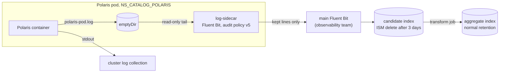

# ADR-081: Polaris logs are filtered in a sidecar into a 3-day candidate index and aggregated by an OpenSearch transform

- **Status:** Proposed
- **Date:** 2026-10-30
- **Related:** ADR-000, ADR-001, ADR-009, ADR-013, ADR-014, ADR-023, ADR-024, ADR-031, ADR-036, ADR-037, ADR-040, ADR-041, ADR-045, ADR-046, ADR-048, ADR-074

## Context

**What is in force today.**

- **ADR-024:** the hand-off to the observability team is a set of files, written by the log
  batch to a location their Fluent Bit reads, under the contract in
  `docs/contracts/polaris-logs.md`. Index templates, ISM policies, Fluent Bit configuration and
  Lua belong to that team. Polaris's stdout stays.
- **ADR-036:** one `ReadWriteMany` claim, `polaris-logs`, in Polaris's namespace. Polaris
  writes one file per pod to it (a file appender in `advancedConfig`), an hourly CronJob
  (`charts/polaris-log-batch`, `images/polaris-log-batch`) re-reads every file, and the
  observability team's reader mounts the claim. Target clusters need a `ReadWriteMany` storage
  class (`POLARIS_LOGS_STORAGE_CLASS`, `POLARIS_LOGS_SIZE` in `.env.template`); the gate has a
  `shared` class.
- **ADR-037:** the batch installs in ADR-045's step 2, and its failure stops the install.
- **Audit policy v5** (the contract, "Policy"): which lines are kept, dropped or counted. It is
  applied today by the batch.

**Why it changes.** Kade's decision on 2026-10-30 (kade-k8s-platform/tasks#2): the full log
should not leave the pod, be stored on a shared claim and be read again every hour. Only the
lines worth keeping leave the pod; what is kept is aggregated inside OpenSearch.

- Dropped-line counters are dropped.
- The candidate index keeps 3 days.
- The aggregate lives in a separate index.
- A transform job, not a CronJob, aggregates.

ADR-014's open question, whether stdout is equivalent to the file, is not answered by
ADR-024, ADR-036 nor the contract. Its reasons are in the archive (`enjay27/lakehouse-k8s`),
and this repository has not cited them: **NOT KNOWN**, see Decision 2.

**Facts this decision rests on** (the documentation of each product, read on 2026-10-30; none
was run for this ADR, and ADR-000 rule 10 applies to every one marked NOT KNOWN):

- Upstream's Polaris chart 1.6.0 has no `extraContainers` value. It renders
  `extraInitContainers` whole as the pod's `initContainers`, and `extraVolumes` into the pod.
  `extraVolumeMounts` go to the Polaris container only. The chart stays unchanged (ADR-009).
- An init container with `restartPolicy: Always` is a native sidecar: it starts before the main
  container and stops after it. The gate's kind node image is Kubernetes 1.36
  (`gates/pins.json`). The target clusters' Kubernetes version is **NOT KNOWN**.
- Fluent Bit has native `grep`, `parser`, `rewrite_tag` and `modify` filters, and a Lua filter
  whose callback may drop a record or return several. It has no timer. Lua changes need a
  restart (ADR-013's archive lesson).
- An OpenSearch index transform groups by `terms`, `date_histogram` or `histogram` and
  aggregates with `sum`, `avg`, `max`, `min`, `value_count`, `percentiles` or
  `scripted_metric`. A continuous job re-transforms the buckets that changed. Its groups and
  aggregations cannot be changed after creation. ISM deletes by index age, not by document.
- Egress from Polaris's namespace is not restricted (ADR-048).

## Decision

### 1. A native sidecar filters the log

- **The sidecar** (placeholder name `log-sidecar`, Fluent Bit, image pinned by digest) is added
  through the chart's `extraInitContainers` with `restartPolicy: Always`. The chart is
  unchanged (ADR-009).
  - It tails the pod's JSON log file, parses and filters it with audit policy v5, and sends
    **only the kept lines** to the observability team's main Fluent Bit.
  - Polaris's **stdout stays as it is** (ADR-024's rule carries over).
- **The file moves to an `emptyDir`.** `extraVolumes` replaces the `polaris-logs` claim with an
  `emptyDir` with a `sizeLimit`, mounted at `/deployments/logs` in Polaris and read-only in the
  sidecar. The size is "sized from a measured hour of Polaris's output" (L1); the appender
  settings in `advancedConfig` stay. Whether the hourly roll stays or becomes a size roll is a
  tuning value (ADR-000 rule 11), L1's.
- **The sidecar's configuration is a ConfigMap** from a local chart that `install/release.py`
  installs in step 1 before Polaris, where ADR-045 installs the claim today. The sidecar's
  config checksum goes in `podAnnotations`, so a changed filter rolls the pods. Whether
  Fluent Bit's hot reload could avoid the roll is **NOT KNOWN** (L1).
- **Precondition:** a target cluster's Kubernetes supports native sidecars (GA in 1.33, stated from
  memory, not checked here). The version of the target clusters is **NOT KNOWN**; the first
  install on one checks it.
- **A sidecar that cannot start keeps the pod from starting.** ADR-037's "failure stops the
  install" is replaced by that: nothing for logs runs in install step 2 any more.
- **Delivery.** The sidecar's read offset lives on the `emptyDir`: a container restart resumes,
  a pod deleted before the sidecar sent a line loses it. This is accepted. The old path lost
  nothing only because the claim outlived the pods.
- **Idempotent document ids are required** so that a retry or a restart does not duplicate a
  line. The contract's `event_id` (the SHA-1 of the raw line) has no Lua builtin; an id
  composed from `hostName`, `timestamp` and `sequence`, which Polaris writes, is unique per
  pod. Which one, L1 decides. Fluent Bit's own `Generate_ID` is **NOT KNOWN** to be stable.

### 2. Policy v5 runs in the sidecar

- **Native filters** do the level rule, the `loggerName` drop, the access-line parse and the
  status and method rules. **Lua** does the `clientSecret` redaction (every line, before every
  rule, with `secret_redacted: true`), the 21 resource-key patterns and the rule order as one
  testable function. The archive had this Lua and checked its parity with the batch on
  2026-10-11 (`step16-batch-lua-parity.py`, in the archive); the port is a known quantity.
  Whether `grep` matches a parsed integer `http_status` is **NOT KNOWN** (L1).
- **Rule 2b is stateless** (Kade, 2026-10-30): every line from `IcebergExceptionMapper` and
  `PolarisServiceImpl` is kept, and only the 404 correction is dropped. Today the batch keeps or
  drops those lines by the access line with the same request id that follows them, which a
  filter that sees the application line first cannot do without state, a hold and a timer it
  does not have. The volume of the extra lines is **NOT KNOWN**; the gate's stand-ins measure it
  (L6).
- **The sidecar reads the file, not stdout.** It cannot see the main container's stdout (the
  kubelet writes it on the node; reading it needs `hostPath`, refused by Pod Security baseline),
  and stdout is text, not JSON (`logging.console.json` is `false`). ADR-014 says stdout "was not
  equivalent to the file for the audit report"; the reasons are **NOT KNOWN** here. L1's first
  test measures the difference on Polaris 1.6.0.
- **The contract moves to v3** (`docs/contracts/polaris-logs.md`): the candidate document and
  the aggregate rows. A change to it is announced to the observability team before it ships
  (ADR-024's rule carries over).

### 3. The candidate index, 3 days

- **A new index** (placeholder `polaris-logs-candidate`, one per day so ISM can delete by age)
  receives the kept lines from the main Fluent Bit.
- **ISM deletes it after 3 days** (`min_index_age: 3d`). A line lives 3 to 4 days. Which ISM
  version the observability team runs is **NOT KNOWN**.

### 4. An OpenSearch transform aggregates; no CronJob

- **A built-in transform job** (or an ingestion pipeline; the one that passes L2/L3's gate)
  reads the candidate index and writes a **separate aggregate index** (placeholder
  `polaris-logs-aggregate`) with normal retention. Nothing in this repository runs on a
  schedule for logs.
- **Conditions, to be proved on the gate's OpenSearch stand-in** (`opensearchproject/opensearch`
  3.6.0, ADR-031) by L2/L3, each **NOT KNOWN** today:
  - the shortest schedule interval a continuous job accepts;
  - whether the source accepts a wildcard or an alias over the daily indices (if not, an
    alias or the rollover alias);
  - the `_id` a bucket document gets, so that a re-run updates and does not duplicate.
- **Groups and aggregations are fixed at creation:** a change is a new job and a new target
  index.

### 5. What the aggregate keeps and loses

The counters of dropped lines are dropped (Kade, 2026-10-30), so only kept lines reach
OpenSearch.

| Row | Possible from kept lines | Lost |
|---|---|---|
| summary (per hour, by `hostName`, `level`, `http_status`) | `by_pod`, `errors_kept`, `errors_4xx`, `errors_5xx` (no 404s), `auth_denied`, `held_orphans`, `bytes_total` of kept lines, `min_record_time`, `max_record_time`, `policy` | `lines_in`, `dropped`, `access_seen`, `access_kept`, `access_counted`, `counted_read/post/404`, `app_dropped_total/404`, the batch's `malformed`, `sources`, `corrupt_files`, `orphans_moved`, `idle_log_files`, `pod_list_error`, the books-balance check, `distinct_resources`, `distinct_principals` |
| resource (hour, `resource`) | `requests`, `writes`, `errors*`, `auth_denied`, `response_bytes` from kept lines | `commit_count`, `commit_ms_*`, the 500-row cap with `__other__`/`__errors__`; `reads` and `last_read_bytes` cover failed reads only |
| principal (hour, `user_principal_name`) | as resource, without `last_*` | the 200-row cap |
| app_dropped | none | all of it; "a logger that appears here for the first time is worth a look" is lost |

A transform has no top-N, so the caps go and cardinality falls on the aggregate index.

### 6. Ownership and what goes when

- **Index template, ISM policy and transform job stay with the observability team** (ADR-024)
  **unless L0b, the agreement with that team on the interface, settles otherwise.** The
  protocol the main Fluent Bit accepts and the endpoint's variable in `.env` are **NOT KNOWN**
  and are L0b's. The gate's OpenSearch stand-in carries a stand-in copy of the template, the
  ISM policy and the transform (ADR-031), and a main Fluent Bit stand-in receives the sidecar's
  output; both are later work.
- **The old path is removed later, by L7, not by this ADR.** The batch, its chart and image, the
  `polaris-logs` claim, the file's `ReadWriteMany` mount, the `shared` storage class,
  `check-logs` and the fixture gate stay in force and green until then. When L7 removes them,
  `POLARIS_LOGS_STORAGE_CLASS` and `POLARIS_LOGS_SIZE` go, and the `ReadWriteMany` requirement
  of ADR-036's Consequences, and with it the open question about target storage for logs.
- **Supersedes ADR-024 and ADR-036.** ADR-036 is already amended by ADR-037, so ADR-000 rule 6
  has it superseded whole. **Amends ADR-037:** its install-order line for the batch (step 2,
  failure stops the install) lapses, and its other text, the batch before the console, is moot.
- **ADR-014, ADR-040, ADR-041, ADR-045 and ADR-074 keep their status lines.** A status holds
  one value and rule 6 forbids a second amendment, so this ADR follows ADR-040 §6's precedent:
  it changes none of them, and their parts about the batch, the claim, the file hand-off and the
  fixture gate lapse when L7 removes those. Whether a small ADR then supersedes or amends them
  is Kade's.
- **Placeholders** (ADR-000 rule 11: tuning values are not ADRs): `log-sidecar`,
  `polaris-logs-candidate`, `polaris-logs-aggregate`. L0b agrees the real names.

## Diagram

## Alternatives considered

- **Keep ADR-024 and ADR-036:** the whole log leaves the pod, needs a `ReadWriteMany` class on
  every target and is re-read each hour. Rejected by Kade's decision.
- **The sidecar reads stdout:** needs `hostPath` (refused by Pod Security baseline) and parses
  text; ADR-014's reason is not known.
- **A node-level DaemonSet filter run by the observability team:** moves Polaris-specific
  parsing to a team that does not own Polaris (ADR-024 rejected shipping raw logs).
- **The batch as a sidecar:** keeps the batch's bookkeeping, which Kade has dropped, and its
  hourly shape.
- **A CronJob that aggregates candidate into aggregate:** Kade chose a transform and no CronJob.
- **Candidate and aggregate in one index:** Kade chose two, so retention differs.
- **Keeping the dropped-line counters:** Kade chose to drop them.
- **A chart patch for `extraContainers`, or a mutating webhook:** a patched chart needs its own
  ADR (ADR-072 for Datahub's one line) and a webhook is a new service; Kade chose the native
  sidecar through `extraInitContainers`.
- **Rule 2b with state (a hold until the access line):** needs state between calls and a timer
  Fluent Bit does not have; a quiet pod would hold a line indefinitely.

## Consequences

- No `ReadWriteMany` class is needed on a target cluster for logs.
- The bookkeeping rows listed in Decision 5 are lost; the books can no longer be balanced.
- A change to the filter rolls Polaris's two pods (a PodDisruptionBudget with `minAvailable: 1`
  keeps one up).
- A pod deleted before the sidecar sent a line loses that line.
- Polaris's ephemeral storage grows by the `emptyDir`'s `sizeLimit`.
- A target cluster below the native sidecar's GA version cannot run Polaris with this ADR.
- The observability team owns the template, the ISM policy and the transform unless L0b says
  otherwise. Work follows in this order: L0b (agreement), L1 (sidecar and contract v3), L2 and
  L3 (template, ISM, transform), L4 to L6 (gates, stand-ins, install), L7 (removal), L8 (living
  documents). The numbering may differ.
- ADR-081 is Proposed: no code enters until Kade accepts it (ADR-001).
