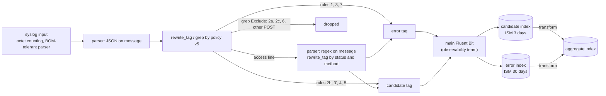

# ADR-082: The Polaris log sidecar uses built-in Fluent Bit filters only, and derived fields are left to OpenSearch

- **Status:** Accepted
- **Date:** 2026-10-30
- **Related:** ADR-000, ADR-001, ADR-009, ADR-016, ADR-024, ADR-031, ADR-050, ADR-081

## Context

**What is in force.** ADR-081 (Accepted 2026-10-30, Decisions 1 to 7): Polaris sends its log
over syslog to a native sidecar, which applies audit policy v5 and forwards the kept lines to
the observability team's Fluent Bit; an OpenSearch transform aggregates. It amends ADR-037 and
supersedes ADR-024 and ADR-036 (its Decision 7); that stays true. Merged since:

- **lakehouse#241:** contract v3 documents.
- **lakehouse#242:** `charts/polaris-log-sidecar`, with `files/policy_v5.lua`, a Lua filter in
  the sidecar's configuration, and a parity corpus run in `static` through `lupa`, pinned in
  `charts/requirements.txt`. This Lua script and `lupa` are what this ADR removes.
- **lakehouse#243:** the measurements of the syslog path (below).

**Why it changes.** Kade's decision of 2026-10-30, passed on from the observability team's
side: no more dependency, not even a Lua script inside Fluent Bit. The sidecar is to be as small
as a Fluent Bit configuration; the goal is sending to the cluster's Fluent Bit, and the tests
are light.

**Facts measured** (lakehouse#243, smoke run 41111268486; cited as measured):

- The ten Quarkus syslog keys work on Polaris 1.6.0.
- The JSON keys `hostName`, `sequence`, `mdc`, `loggerName` and `timestamp` (nanoseconds) are
  present on the stream.
- Every message starts with a UTF-8 BOM, and Fluent Bit 5.1.4 keeps it in `message`.
- `max-length` counts the whole frame (about 165 octets of envelope).
- `discard` loses lines, not requests.

**Facts read** on 2026-10-30 from docs.fluentbit.io, **not run**:

- `parser` filter: a regex or JSON parser on a key; `reserve_data` and `preserve_key` control
  what is kept.
- `grep`: `Regex` or `Exclude` on one key; a record without the key is not matched.
- `rewrite_tag`: `Rule $KEY REGEX NEW_TAG KEEP`. The re-emitted record is filtered again under
  its new tag, so a filter's `Match` must not match the new tags. The emitter buffers in memory
  unless `emitter_storage.type filesystem`, which is a file and so refused.

Each point that depends on these reads is marked **NOT KNOWN** below.

**A fact of OpenSearch 3.6.0:** the transform's double, in scientific notation, is refused for
a date mapping (lakehouse L3a's smoke run 41113377960).

## Decision

### 1. The sidecar's filters are `parser`, `grep` and `rewrite_tag` only

- No `lua` filter, no script file, no `modify`, no new test dependency (`lupa` goes), no new
  runtime dependency or image. The sidecar stays Fluent Bit at the pinned image with a
  ConfigMap from `charts/polaris-log-sidecar`.
- Everything else of ADR-081 Decision 1 stays: the native sidecar through
  `extraInitContainers`, syslog on `127.0.0.1`, octet counting, the Quarkus keys, `discard`,
  the memory buffer, the output to an input of the main Fluent Bit, no file.
- **The BOM is handled by the syslog input's regex parser**, not by a script. The sidecar's
  `polaris-syslog` parser (a copy of the image's `syslog-rfc5424`) ends `(?<message>.+)$`; it
  gets an optional BOM group in front of `message`. Which spelling Fluent Bit's regex engine
  takes (`(?:\xEF\xBB\xBF)?` or `\x{FEFF}`) is **NOT KNOWN**; the smoke step proves it. If
  neither works, the fallback is a second `parser` filter with a regex parser on `message` that
  captures the text after an optional BOM (`reserve_data` and `preserve_key` as the smoke step
  finds; whether a parser may overwrite the key it reads is **NOT KNOWN**).
- Then the JSON `parser` filter on `message` (as merged), then the routing of Decision 2.

### 2. Policy v5 by `grep` and `rewrite_tag`, first match wins by order

One condition per filter, one `Rule` per `rewrite_tag` filter, `KEEP false`, every filter's
`Match` an exact tag so that a re-tagged record is not filtered by the stage it left. The
multi-rule semantics of `rewrite_tag` (whether a record matching two rules is emitted twice)
are **NOT KNOWN** and avoided; they are stated so that a later change does not assume them. The
input tag is `polaris`. Parsed values stay strings, so every condition is a regex on a string
(this closes ADR-081's question whether `grep` matches a parsed integer, by avoiding it).

| Rule | Condition on strings | Filter | Known |
|---|---|---|---|
| 1 | `level` is `ERROR` or `WARN` | `rewrite_tag` `$level ^(ERROR\|WARN)$` to an error tag | regex on a string key: documented; the smoke step proves one line |
| access line | `loggerName` is `io.quarkus.http.access-log` | `rewrite_tag` to `polaris.access` | same |
| 2b | `loggerName` is `IcebergExceptionMapper` or `PolarisServiceImpl` (and rule 1 did not take it) | `rewrite_tag` to a candidate tag | same; alternation inside one regex, not two rules |
| 2a, 2c | any other record with a `loggerName` | `grep` `Exclude loggerName .+` on the tag `polaris` (what is left after the three stages above) | `grep` on a present string key: documented |
| 7 | what remains has no `loggerName` (a line whose JSON did not parse) | `rewrite_tag` `$message .+` to an error tag | **NOT KNOWN** until the smoke step: the key `message` survives a failed JSON parse |
| access: parse | `message` into `client_ip`, `user_principal_name`, `http_method`, `api_path`, `http_status`, `response_size` | `parser` filter, regex parser (the access pattern `%h %l %u %t "%r" %s %b` written as a Fluent Bit regex), no `Types` | regex parser: documented; the translation of the pattern is proved by the chart rework |
| 3' | `http_status` is `404` | `rewrite_tag` `$http_status ^404$` to a candidate tag | documented |
| 3 | `http_status` 400 to 599 except 404 | `rewrite_tag` `$http_status ^[45][0-9][0-9]$` to an error tag (404 has left already) | documented |
| 4 | `http_method` is PUT, DELETE or PATCH | `rewrite_tag` `$http_method ^(PUT\|DELETE\|PATCH)$` to a candidate tag | documented (a failed one left at rule 3) |
| 6 | successful GET or HEAD | `grep` `Exclude http_method ^(GET\|HEAD)$` (statuses of 400 and above have left) | documented |
| 5 and other POST | `http_method` POST, then a path under `/api/management/` | `rewrite_tag` `$http_method ^POST$` to `polaris.post`, then there `rewrite_tag` `$api_path ^/api/management/` to a candidate tag, then `grep` `Exclude api_path .+` drops the rest | two stages because one rule tests one key; documented; the chain is the smoke step's |
| 3 (unparsed), 7 (other method) | an access line that did not parse, or a method not listed | what remains of `polaris.access`: `rewrite_tag` `$message .+` to an error tag | **NOT KNOWN** until the smoke step (as rule 7 above) |

- The rule order is ADR-081 Decision 3's table unchanged, with its three indices, its two
  placeholder choices (2b, 7) and 404 to the candidate index. What changes is how each row is
  decided, and that **`policy_rule`, `index_class` and `policy` are no longer fields of the
  document**: the new tag carries the index and the rule (for example `polaris.candidate.r4`,
  `polaris.error.r3`; the spellings are placeholders), and the document keeps the Polaris and
  parsed access fields only. The main Fluent Bit routes by tag to the candidate or the error
  index; whether its input keeps the tag is **NOT KNOWN** (the observability agreement, L0b).
  The index tells `index_class` to OpenSearch.
- **Expressible with `grep` or a regex, known from the documentation:** every row above except
  the two marked NOT KNOWN.
- **NOT KNOWN until a smoke send:**
  - (a) the BOM regex spelling;
  - (b) that a re-emitted record is filtered again only under its new tag, with the chain of
    exact `Match` tags and no loop;
  - (c) that `message` survives a failed JSON parse;
  - (d) `rewrite_tag` multi-rule semantics (avoided);
  - (e) the emitter's memory limit under a burst (the filter's `emitter_mem_buf_limit`; a
    tuning value, ADR-000 rule 11).
- **Not expressible, withdrawn:** the redaction (ADR-081 Decision 2's rule `*` with
  `secret_redacted: true`), the 21 resource-key patterns, the SHA-1 or composed `event_id`,
  `status_class`, `resource_kind` and `api_kind`. A rule that depends on a record's neighbour
  does not remain: rule 2b is stateless.
- **Still read, narrower:** ADR-081's requirement that the JSON carry the fields the policy
  reads. The policy now reads `level`, `loggerName` and `message` and the parsed access
  fields; `mdc.requestId` is not read. Contract v3 documents hold raw fields only (Decision 4).

### 3. The sidecar adds no derived field and does not redact

- `resource`, `resource_kind`, `api_kind`, `status_class` and `event_id` are not computed in
  the sidecar. The observability team's OpenSearch computes them (an ingest pipeline, an item of
  L0b) **or they are not done**. Until a pipeline exists the documents hold raw fields:
  Polaris's own (`timestamp`, `loggerName`, `level`, `message`, `hostName`, `sequence`,
  `threadName`, `threadId`, `mdc`, `exception`) and the parsed access fields (`client_ip`,
  `user_principal_name`, `http_method`, `api_path`, `http_status` and `response_size`, as
  strings, kept as parsed).
- ADR-081 Decision 1's idempotent id is withdrawn for the sidecar: it sets no id. `hostName`,
  `timestamp` and `sequence` are all present (lakehouse#243: `sequence` unique on all 89 lines,
  `(hostName, sequence)` unique), so the observability team's pipeline can compose `_id` from
  them, or a resend duplicates a line; delivery is already lossy (ADR-081 Decision 1,
  "Delivery", stays).
- a credential-bearing log line is not redacted by the sidecar; a security follow-up decides.
  ADR-081's redaction rule and the contract's `secret_redacted` are withdrawn by this decision.

### 4. The aggregate keeps raw fields; the time-range fields go

- The transform's groups can only be raw fields: `window_start`, `hostName`, the index (a
  kind), `level`, `http_method`, `http_status`, `user_principal_name`, and `api_path` as a raw
  string (its cardinality is **NOT KNOWN** and likely high: one value per table; normalising
  to `resource` solved that). The metrics: `lines` (a count) and `response_bytes` (a sum of a
  string-typed field needs the pipeline's conversion: **NOT KNOWN**; if there is no pipeline,
  `response_bytes` goes). A `resource` roll-up, the kind and the status class return only when
  the observability team's pipeline exists; this ADR does not promise them.
- `min_record_time` and `max_record_time` are dropped from the aggregate document, because
  OpenSearch 3.6.0 refuses the transform's double in scientific notation for a date mapping.
  `window_start` stays the bucket's time.
- ADR-081 Decision 6's table, as amended; resource normalisation is lost until the pipeline
  exists, and the counters ADR-081 already lost stay lost:

| Row | Possible from raw fields | Lost |
|---|---|---|
| summary (per hour) | `by_pod` by `hostName`; errors by `level` or `http_status` ranges; the 404 count by `http_status`; `auth_denied` as 401 and 403 by `http_status`; `lines` | `policy`, `min_record_time`, `max_record_time`, `status_class` |
| resource | per `api_path` as a raw string (cardinality NOT KNOWN) | resource normalisation, until the pipeline exists |
| principal (hour, `user_principal_name`) | as summary, per principal | `last_*` |

- The files `docs/contracts/polaris-logs-v3-*` and `polaris-logs.md` follow this decision; the
  contract rework carries them (L1b). This ADR does not touch them.

### 5. The gate is light

- **Static (every push, ADR-050):** render checks on `charts/polaris-log-sidecar`:
  - the chart renders;
  - the rendered Fluent Bit configuration uses only the filter names `parser`, `grep` and
    `rewrite_tag` (no `lua`, no `script`, no `modify`);
  - each `rewrite_tag` has one `Rule` and `KEEP false`;
  - no filter's `Match` matches a tag emitted by a `rewrite_tag` before it (a pure check on the
    rendered strings);
  - the values schema and kubeconform as today (ADR-016).

  No Lua tests, no `lupa`, no 20-example parity corpus.
- **Smoke (ADR-050): one step** in the existing smoke job. It sends real log lines (a
  Polaris-shaped syslog frame, octet counting, with the BOM, taken from the measured first
  frame) to a Fluent Bit stand-in running the rendered configuration at the pinned image, and
  reads what comes out by tag. One line per route is enough: an ERROR line, a 404 access line,
  a failed 500 access line, a PUT, a successful GET dropped, an unparsed line. It proves NOT
  KNOWN items (a) to (c). It also carries **a short restart probe** (about one minute, not a
  long proof): stop the sidecar, send, restart it, send, and see the second line arrive. That
  proves that Polaris's syslog handler reconnects after a sidecar restart, which ADR-081
  Consequences item 5 left unproved. Lines logged while the connection is down are lost either
  way (`block-on-reconnect` false). Where the step lives (a function in `gates/` next to the
  syslog probe, or a new file) is the chart rework's call. The receiver is the main Fluent Bit
  stand-in of ADR-081 Decision 7.
- **Withdrawn:** ADR-081's proofs that need an OpenSearch transform stand-in (Decision 5's three
  conditions as gate checks; Decision 7's stand-in copies of templates, ISM policies and
  transform), `check-logs` v3 as a full scenario (the sidecar's output into an OpenSearch
  stand-in and the aggregate read back), and the Lua parity corpus. The planned OpenSearch
  stand-in task is cancelled; its branch is kept as reference, not merged.
- **What the merged proofs keep proving** (lakehouse#243, `gates/gate.py check-logs` through
  `gates/syslog_probe.py`, `syslog_receiver.py` and `syslog_load.py`): the ten Quarkus keys take
  effect on Polaris 1.6.0; the frame is octet-counted and `max-length` counts the whole frame;
  the BOM is there; a stalled receiver with `discard` loses lines and no request; the JSON
  keys. They are unchanged, still run in smoke, and are the evidence for ADR-081 Decision 1,
  which this ADR keeps. They do not prove the filters: the new smoke step does.

### 6. Ownership

Unchanged from ADR-081 Decision 7 for the templates, the ISM policies (3 and 30 days) and the
transform (the observability team, unless L0b says otherwise). The transform's open conditions
(ADR-081 Decision 5: the shortest interval, an alias or pattern over both kinds, the bucket
`_id`) are no longer proved on the gate; they stay **NOT KNOWN**, for the observability team.
The ingest pipeline for derived fields is an item of L0b. The old path stays until L7.

### 7. What this means for the tasks

| Task | Change |
|---|---|
| Chart rework | Remove `files/policy_v5.lua`, the `lua` filters, the Lua test file and `lupa` from `charts/requirements.txt`; the new configuration of Decisions 1 and 2; the static checks and the one smoke step of Decision 5 |
| Contract rework (L1b) | Shrunk to the raw fields and the dropped time fields: contract text, schemas, template, transform |
| OpenSearch stand-in task and the sizing task | Cancelled (the BOM moves into the parser; `app-name` and `max-length` sizing, if still wanted, belongs to the chart rework) |
| Agreement with the observability team (L0b) | Adds the ingest pipeline and the input that keeps the tag |

Work order: this ADR, then the contract rework, the chart rework and L0b in parallel, then the
install and gate work, L7, L8. ADR-081's last Consequences bullet ("ADR-081 is Proposed") and
its text on Lua are not edited (ADR-000 rule 5); this ADR withdraws them by section, as above.
The living documents (`CLAUDE.md` rows for `charts/polaris-log-sidecar` and its Lua test) are
L8's.

## Diagram

## Alternatives considered

- **Keep Lua (ADR-081 as merged, lakehouse#242):** rejected by the rule of no more dependency,
  not even a Lua script; it also needs `lupa` in the tests and a pod roll on a change.
- **A WASM filter:** a new runtime and a toolchain to build it; same rule.
- **An ingest pipeline for everything (filtering and routing in OpenSearch):** the full log
  would have to leave the pod, which ADR-081 removed, and it needs credentials the team does not
  permit; it is not a filter before indexing.
- **One-stage Data Prepper:** already a fallback of ADR-081 (a new component, Kade's call, with
  its upkeep cost); not reached, since the built-in filters suffice on paper.
- **The `modify` filter to add `index_class` and `policy_rule`:** not among the three filters
  chosen; the tag carries both.
- **Redaction by a regex `parser` or by `grep Exclude` of credential-bearing lines:**
  `grep Exclude` would drop the lines, which was not chosen; a parser cannot rewrite in place.
  Deferred to the security follow-up of Decision 3.
- **`Types http_status:integer` and comparing as numbers:** avoided; the question of `grep` on
  integers stays closed by using strings.
- **Two outputs or two streams instead of tags:** a second connection to the main Fluent Bit;
  tags are enough if its input keeps them (L0b).

## Consequences

- No Lua, no `lupa`; a smaller sidecar and a cheaper gate; `charts/requirements.txt` loses a
  pin.
- Documents keep raw fields until the pipeline exists; the aggregate loses resource
  normalisation, kind, status class and `event_id` (and the `min` and `max` time fields) until
  then, or for good.
- Credential-bearing lines are uploaded as they are (Decision 3), until the follow-up decides.
- A resend can duplicate a line without an `_id`; the observability team can set one from
  `hostName`, `timestamp` and `sequence` (L0b).
- A smaller proof set: the filters are proved by one smoke step on a few lines, not by a
  corpus. A rule that behaves differently on real traffic is found in the sizing run on the
  gate or after install.
- The reconnect after a sidecar restart is proved by the probe in the smoke step (Decision 5).
- ADR-082 is Proposed: no code enters until Kade accepts it (ADR-001); the chart rework and
  the contract rework follow.

**NOT KNOWN, collected** (ADR-000 rule 10):

- The five smoke items (a) to (e) of Decision 2, proved by the smoke step of the chart rework.
- `api_path` cardinality; whether a string `response_size` can be summed.
- Whether the main Fluent Bit's input keeps the tag; the pipeline's owner and form (L0b).
- The transform's interval, its source over two indices and its bucket `_id` (the
  observability team's, no longer proved here).
- The Kubernetes and ISM versions on targets (as ADR-081).
