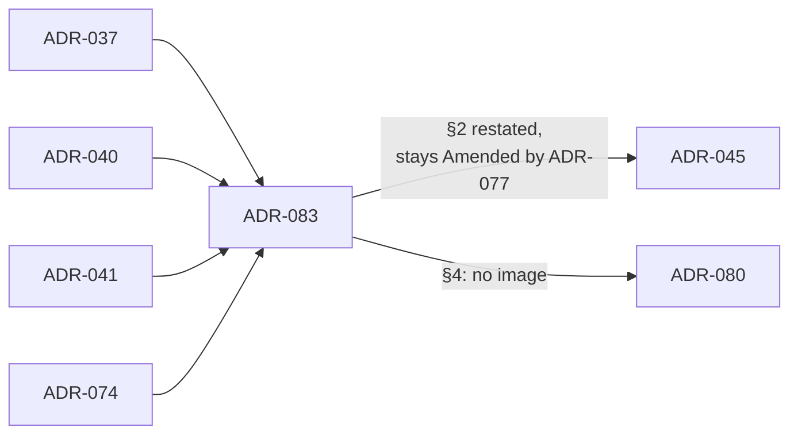

# ADR-083: The log batch, its fixture and log-batch gates and its image are retired, and the install order loses the claim and the batch

- **Status:** Amended by ADR-084
- **Date:** 2026-11-02
- **Related:** ADR-000, ADR-036, ADR-037, ADR-039, ADR-040, ADR-041, ADR-042, ADR-045, ADR-050, ADR-074, ADR-077, ADR-080, ADR-081, ADR-082

## Context

ADR-081 moved Polaris's logs to a sidecar and left the old path "in force until removed". It
kept the status lines of ADR-014, ADR-040, ADR-041, ADR-045 and ADR-074 and left to Kade
whether a small ADR would then supersede or amend them. Kade chose, on 2026-11-02, one small
superseding ADR.

Since then the old path has left the gates and the install:

- gate-check no longer requires a log-batch run (lakehouse#252);
- `log-batch.yml`, `create-fixtures.yml`, `gates/log_batch_gate.py` and `gates/fixtures.py`
  are removed (#253);
- `check-logs` reads the sidecar's output, contract v2 is gone, and `gates/logs_traffic.sh`
  with it (#254);
- `install/release.py` has no log claim and no batch step; an empty `POLARIS_LOG_OUTPUT_HOST`
  stops the install at the sidecar's ConfigMap (#255).

So ADR-037, ADR-040, ADR-041 and ADR-074 describe things that are gone or about to go. Checked
at `359fa36`: the files above are absent; `charts/polaris-log-batch`, `images/polaris-log-batch`,
`batch-image` and `LEGACY_ENV` are still present.

## Decision

1. **Supersedes ADR-037, ADR-040, ADR-041 and ADR-074, each whole.** ADR-037 and ADR-040 are
   already amended, so ADR-000 rule 6 allows only this. ADR-041's subject is the removed gate;
   ADR-074 names the batch's image.
2. **ADR-045 is restated, its text and status (Amended by ADR-077) unchanged.** Step 1,
   Polaris item 5 is the log sidecar's ConfigMap (ADR-081, ADR-082), where an empty
   `POLARIS_LOG_OUTPUT_HOST` stops the install. Step 2 is the console alone, never blocking
   (ADR-028). Its Context and Diagram lines naming the claim and the batch read the same way.
3. **What lapses with no status change.** ADR-040 §5's amendment of ADR-039 (the log-batch
   requirement) and ADR-050's `log-batch` level. ADR-039 (a passing dry-run and smoke on a
   platform PR's head) and ADR-050 otherwise stand. ADR-014 stays as ADR-081 left it.
4. **ADR-080 §4 (Proposed) is edited:** Candidate builds and pushes no image, the tag job needs
   the gates only, the notes name no image, Promote is unchanged.
5. **Images already on GHCR** (`ghcr.io/enjay27/lakehouse/polaris-log-batch` and
   `ghcr.io/kade-k8s-platform/lakehouse/polaris-log-batch`) are neither deleted nor made private
   by this ADR; a release cut before still pulls its own default. ADR-031 keeps its rules:
   stand-ins are pinned and never in a release.
6. **Still to come, in later changes** (removals, not new behaviour): the batch chart and image,
   `batch-image`, `batch_image()`, `image_registry()`, the `IMAGE_REGISTRY` comment, the
   Candidate `image` job and the notes line, the batch diagnostics in `smoke.yml` and
   `stress.yml`, and `charts/test_polaris_log_batch.py`; then, after the next release cut from
   `main` (the upgrade job installs the last release), the gate's `shared` class,
   `SHARED_*`, `TIMELINE_CLAIMS`, `GATE_LOGS_SIZE` and `LEGACY_ENV`. The dead
   `standin_images.opensearch` and `fluent_bit` pins are not planned. Until then those files
   exist without an ADR in force.

## Diagram

## Alternatives considered

- **Amend each:** rule 6 forbids a second amendment for ADR-037 and ADR-040.
- **Supersede ADR-045 too:** Kade wants it kept; superseding restates the whole order for two
  lines.
- **Leave every status as ADR-081 did:** the index would keep calling the batch ADRs in force.
- **Include ADR-039:** its subject, gate-check, is live.
- **Keep the image build for old rollbacks:** a rollback pulls the image its release was cut with.

## Consequences

- The ADR set matches the code at `359fa36`.
- The removals in Decision 6 need this ADR Accepted first. ADR-080 stays Proposed.
- ADR-039 stays "Amended by ADR-040", ADR-050 "Amended by ADR-055" and ADR-014 "Amended by
  ADR-036", each pointing at a superseded ADR; a later ADR superseding them whole would clean it.
