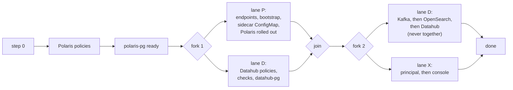
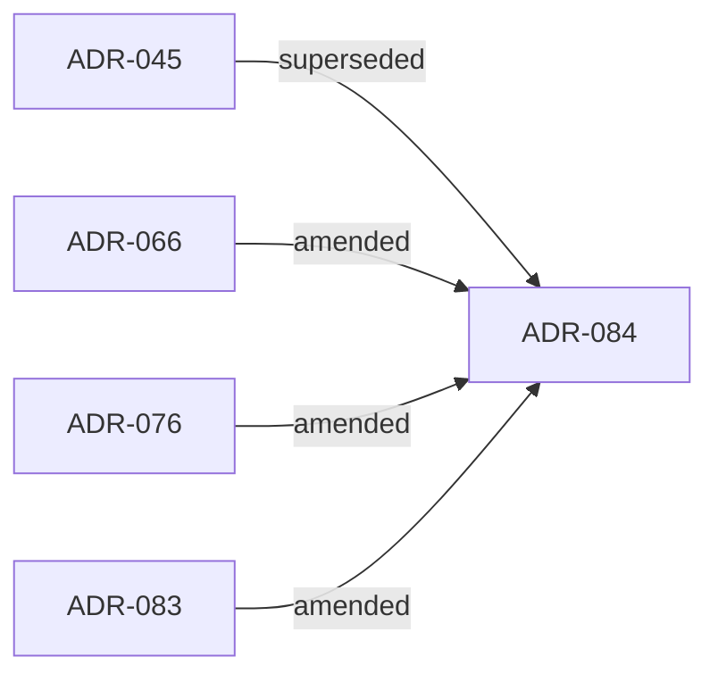

# ADR-084: A release installs in a fixed order with two overlaps, and never two JVM start-ups together

- **Status:** Proposed
- **Date:** 2026-11-03
- **Related:** ADR-000, ADR-004, ADR-006, ADR-007, ADR-012, ADR-018, ADR-026, ADR-028, ADR-029, ADR-031, ADR-036, ADR-043, ADR-044, ADR-045, ADR-048, ADR-066, ADR-068, ADR-070, ADR-071, ADR-076, ADR-077, ADR-081, ADR-082, ADR-083

## Context

ADR-029 restated the install order of a release in full. ADR-043 and ADR-044 amended it,
ADR-045 restated it whole, ADR-077 amended ADR-045's "gates use the same script" bullet, and
ADR-083 restated its Polaris item 5 and its step 2. ADR-045 is already amended, so ADR-000
rule 6 leaves only a new ADR that supersedes it whole.

The order is serial, and most waits are idle for most of their length: CNPG's initdb and join
Jobs with gaps of 10 to 20 s, a short-lived pod, a light rollout. A fresh smoke install took
566 s (smoke-fresh, CI run 41548035508); about 110 s of it is waits that depend on nothing in
front of them.

ADR-077 left the stores-together change out because it is a change to every release's order
(ADR-045 §2). An experiment branch (`exp/parallel-install`, head `49c9aa3`) ran whole chains
in parallel: the gain was inside the run-to-run noise, and its only CPU datum showed Kafka
plus OpenSearch no faster together than one after the other (45 s against about 40 s). So the
claim that the stores gain from overlap is **unproven**, and stays open.

Kade chose, on 2026-11-03, two forks, at most two lanes, and never two JVM start-ups together.

## Decision

1. **Supersedes ADR-045 whole.** Its order is restated here and stays in force, unchanged:
   - who installs the operator, the plugin and cert-manager (ADR-029, ADR-043);
   - step 0, the preconditions, checked;
   - inside each service's part. Polaris: its network policies, polaris-pg ready, the S3 and
     policy endpoints answering, the realm bootstrap, the log sidecar's ConfigMap with the stop
     on an empty `POLARIS_LOG_OUTPUT_HOST` (ADR-081, ADR-082), Polaris. Datahub: its network
     policies, the checks and datahub-pg (ADR-066), Kafka (ADR-068), OpenSearch (ADR-070),
     Datahub (ADR-071), its Polaris principal (ADR-076);
   - step 2, the console alone, never blocking (ADR-028);
   - removal in reverse and destructive (ADR-004);
   - ADR-077 §1: the datahub-recovery job composes step 0 and Datahub's part in its own serial
     order, and `release.py` gains no mode.

   The first step with a problem stops the rest.
2. **Two forks, in lanes.** Serial: step 0, Polaris's network policies, polaris-pg ready.
   - **Fork 1:** lane P (the endpoints, the bootstrap, the sidecar's ConfigMap, Polaris,
     rolled out) beside lane D (Datahub's network policies, its checks, datahub-pg ready).
     Both are done before the next step.
   - **Fork 2:** lane D (Kafka, OpenSearch, Datahub) beside lane X (the principal, then the
     console, whose failure stays a note, ADR-028).

   Both done means the install is done.
3. **Limits.** At most two lanes at once. Never two JVM start-ups together: Polaris's rollout,
   Kafka, OpenSearch and Datahub's Jobs and GMS are one after another, so Kafka starts after
   Polaris is rolled out. Kafka and OpenSearch stay serial (ADR-070). `--dry-run` runs every
   step one after another, as today. The datahub-recovery job stays serial. Each step's order
   and waits, `SETTLE_READS`, `SETTLE_INTERVAL` and every timeout are unchanged; no check is
   weakened.
4. **Failure.** A lane runs its steps in order and stops at its first problem. A stop event
   ends the other lane's waits only (`kubectl wait`, `kubectl rollout status`, the settle's
   sleep); a lane starts no other step after it. `helm` and `kubectl run` are never killed (a
   killed `helm upgrade --wait` leaves a release `pending-upgrade`); they finish within their
   own timeouts. A wait ended by the stop event is not reported as a failure, a note says it
   was stopped; two real failures at once are both reported. Problems and notes are printed
   in install order (lane P, lane D, lane X; steps in order), never in the order they
   finished. The console lane's problem is a note and sets no stop event (ADR-028). The
   cluster is left as at the failure point; nothing is rolled back.
5. **What this replaces exactly in the ADRs it amends.** Each is named by its text, not by a
   line number.
   - **ADR-066:** "after Polaris, Datahub's network policies, then its PostgreSQL" (Context),
     "after Polaris's" in step 1's Datahub part, and the diagram label "after Polaris" become
     "Datahub's network policies start once polaris-pg is Ready, beside Polaris's endpoints,
     bootstrap and rollout (lane D, fork 1)". "Step 1 stops otherwise, after Polaris is
     installed" becomes "stops otherwise; Polaris may be only partly installed, the cluster is
     left as at the failure". Its items 1 to 3 and everything else stand.
   - **ADR-076:** "step 1 gains a last part, after Datahub" becomes "after Polaris is rolled
     out, in lane X beside Kafka, OpenSearch and Datahub; the console follows it in the same
     lane". Its five numbered items, the idempotent reset and the root credential stand.
   - **ADR-083:** Decision 2 is replaced by §1 and §2 here, which restate the whole order
     including the sidecar's ConfigMap and the console-alone step 2. Its other five decisions
     stand.

   ADR-045 becomes `Superseded by ADR-084`; ADR-066, ADR-076 and ADR-083 become
   `Amended by ADR-084`. Everything else is untouched. ADR-068, ADR-070 and ADR-071 (Kafka
   after datahub-pg, OpenSearch after Kafka, Datahub after its three stores) stand as
   written, and so do ADR-044, ADR-048, ADR-079, ADR-081 and ADR-082, whose citations of
   ADR-045 name it as it was. ADR-029 stays `Superseded by ADR-045`, a chain.
6. **Code follows once this ADR is Accepted** (ADR-001): `install/release.py` and its tests,
   in a later change. Until it merges the install runs serially, and this order is the target.

## Diagram

## Alternatives considered

- **Amend ADR-045 again:** ADR-000 rule 6 forbids a second amendment.
- **No overlap, no ADR:** nothing is risked, and about 110 s stays on the table.
- **Three overlaps (fork 1, Kafka with OpenSearch, the console beside Datahub):** two JVM
  start-ups together with no measured gain, and the principal's idle time stays on the path.
- **Whole chains in parallel from the start (the experiment):** a gain inside the noise, and
  three heavy start-ups at once.
- **Kill `helm` on failure:** leaves releases `pending-upgrade`.
- **Edit ADR-066 and ADR-076 in place:** rule 5 forbids it for Accepted ADRs.
- **Leave them standing and say "the later ADR wins":** rule 6 wants the amended status and
  the exact text replaced.

## Consequences

- About 110 s less on a fresh install: an estimate to be measured by the code change, not a
  promise.
- A failed install may leave the console installed and Polaris partly rolled out; the cluster
  is left as at the failure.
- Step 1's stop on a missing Secret can now come while Polaris is still rolling out.
- Output order is fixed by install order, not by finish order.
- Starting Kafka with OpenSearch later needs a new ADR (it changes Decision 3) and a
  measurement after the image preload.
- The recovery job and ADR-077 §1 do not move. Bringing it into the lanes would change ADR-077.
- The statuses of ADR-045, ADR-066, ADR-076 and ADR-083 change, and the index follows.
- The code that does this is not written yet (Decision 6).
