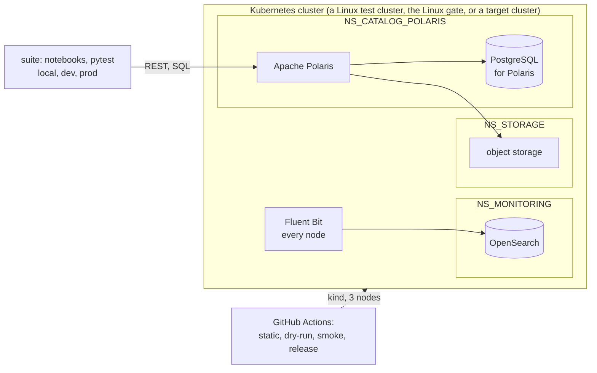

# lakehouse: Architecture Decision Records

The decisions this repository is built from (ADR-001). Nothing outside `docs/adr/` is trusted
until an ADR covering it is Accepted. See [ADR-000](000-adr-process-and-template.md) for how
these records are written and changed.

## Status legend

| Status | Meaning |
|---|---|
| **Accepted** | Decided. Build on it. |
| **Accepted (details proposed)** | The core decision is made; some details inside are still suggestions. |
| **Proposed** | Suggested, not yet confirmed. Confirm, change, or reject before building on it. |
| **Deferred** | Decided to decide later; recorded so nobody builds around an assumption. |
| **Rejected** | Dropped. Kept for history so that it is not proposed again. |
| **Superseded by ADR-NNN** | Replaced. Kept for history. |
| **Amended by ADR-NNN** | Still in force, except the part that ADR-NNN replaces. Read both. |

## System at a glance

## Index

| # | Title | Status |
|---|---|---|
| **Process and repository** | | |
| [000](000-adr-process-and-template.md) | ADR process and template | Amended by ADR-052 |
| [001](001-the-repository-starts-from-its-decision-records.md) | The repository starts from its decision records; code enters only under an Accepted ADR | Accepted |
| [002](002-the-repository-is-public-and-configuration-lives-in-env.md) | The repository is public; environment-specific configuration lives in `.env` | Accepted |
| [003](003-state-lives-in-labelled-issues-and-the-pr-is-the-session-record.md) | State lives in labelled issues of this repository; the PR is the session record | Amended by ADR-073 |
| **Environments and credentials** | | |
| [004](004-the-platform-targets-linux-only.md) | The platform targets Linux only; releases are proven on the Linux gate; target clusters are never reached | Accepted |
| [005](005-the-suite-runs-in-three-environments-with-guards.md) | The suite runs in three environments, each with its own guards | Accepted |
| [006](006-credentials-are-never-committed.md) | Credentials are never committed; an init-env script generates them per clone and creates the Secrets | Accepted |
| **Platform** | | |
| [007](007-namespaces-by-service-type-named-in-env.md) | Namespaces are split by service type, and their names come from `.env` | Amended by ADR-023 |
| [008](008-each-service-has-its-own-postgresql.md) | Each service has its own PostgreSQL, in the service's namespace | Accepted |
| [009](009-the-iceberg-catalog-is-apache-polaris.md) | The Iceberg catalog is Apache Polaris, from a local chart at a pinned version | Accepted |
| [010](010-postgresql-runs-on-the-cloudnativepg-operator.md) | PostgreSQL runs on the CloudNativePG operator, one `Cluster` per service | Amended by ADR-029 |
| [011](011-object-storage-is-minio.md) | Object storage is MinIO, from a local chart at a pinned release | Superseded by ADR-023 |
| [012](012-install-order-operators-first-then-storage-services-monitoring.md) | Install order: operators, storage, then each service's PostgreSQL and the service, then monitoring | Superseded by ADR-029 |
| [013](013-logs-ship-to-opensearch-in-the-monitoring-namespace.md) | Logs ship with Fluent Bit to OpenSearch, which runs in the monitoring namespace | Superseded by ADR-024 |
| [014](014-polaris-writes-one-log-file-per-pod-for-an-hourly-batch.md) | Polaris writes one log file per pod, read by an hourly batch released separately | Amended by ADR-036 |
| **Measurement and verification** | | |
| [015](015-measurements-run-on-the-plain-upstream-schema.md) | Measurements run on the plain upstream Polaris schema; no custom indexes | Accepted |
| [016](016-settings-are-verified-on-the-running-object.md) | A setting is verified on the running object against the chart default, never in the values file | Accepted |
| **Gates and releases** | | |
| [017](017-the-linux-gate-cluster-is-kind-with-three-nodes.md) | The Linux gate cluster is kind with three nodes on a GitHub-hosted runner | Amended by ADR-023 |
| [018](018-dry-run-and-smoke-gates-run-from-gate-branches.md) | Dry-run and smoke gates run from throwaway `gate/*` branches on the PR's exact commit | Superseded by ADR-038 |
| [019](019-a-platform-pr-merges-only-when-a-dry-run-covers-its-head.md) | A platform PR merges only when a passing dry-run gate covers its head | Superseded by ADR-039 |
| [020](020-a-release-tag-is-created-only-by-the-release-workflow.md) | A release tag is created only by the release workflow, after the full Linux gate | Superseded by ADR-033 |
| [021](021-gates-upgrade-from-the-last-release-rebuilt-from-its-tag.md) | Gates upgrade from the last release, rebuilt from its tag; no machine snapshots | Superseded by ADR-051 |
| [022](022-claude-prs-merge-through-the-auto-merge-workflow.md) | Claude's PRs merge through an auto-merge workflow once every check on the head is green | Amended by ADR-030 |
| **Scope and integration** | | |
| [023](023-other-teams-services-are-interfaces-with-stand-ins-on-the-gate.md) | Other teams' services are interfaces in `.env`, with stand-ins only on the gate | Superseded by ADR-031 |
| [024](024-the-log-batch-hands-processed-files-to-the-observability-teams-fluent-bit.md) | The log batch hands processed files to the observability team's Fluent Bit | Superseded by ADR-081 |
| [025](025-datahub-with-postgresql-on-cnpg-a-small-kafka-and-a-small-opensearch.md) | Datahub runs with PostgreSQL on CloudNativePG, a single-broker Kafka and a small OpenSearch | Accepted |
| [026](026-polaris-issues-its-own-tokens-and-asks-an-opa-policy-endpoint.md) | Polaris issues its own tokens and asks an OPA policy endpoint; principals are created by the catalog gateway | Accepted |
| [027](027-ingress-is-denied-by-default-and-allowed-per-caller.md) | Ingress to this repository's namespaces is denied by default and allowed per caller | Superseded by ADR-044 |
| [028](028-the-polaris-console-is-a-maintainer-tool-outside-the-release-path.md) | The Polaris console is a maintainer tool, built from a pinned commit and kept off the release path | Accepted |
| [029](029-the-cnpg-operator-belongs-to-the-operator-team-installed-here-only-on-the-gate.md) | The CloudNativePG operator belongs to the operator team; this repository installs it only on the gate and test clusters | Superseded by ADR-045 |
| [030](030-auto-merge-leaves-prs-that-change-the-merge-rules-or-the-checks-to-kade.md) | Auto-merge leaves PRs that change the merge rules or the checks to Kade | Amended by ADR-059 |
| [031](031-other-teams-services-are-interfaces-stand-ins-only-on-the-gate-seaweedfs-for-s3.md) | Other teams' services are interfaces in `.env`; stand-ins only on the gate, SeaweedFS for S3 | Amended by ADR-034 |
| [032](032-a-cleanup-workflow-deletes-merged-claude-branches-and-their-gate-branches.md) | A cleanup workflow deletes merged `claude/*` branches and their `gate/*` branches | Amended by ADR-049 |
| [033](033-release-candidates-are-gated-on-a-pr-from-main-into-rc-the-release-workflow-tags-rc.md) | Release candidates are gated on a PR from `main` into `rc`; the release workflow tags `rc` | Superseded by ADR-080 |
| [034](034-recording-proxies-on-the-gate-prove-each-connection-and-its-exchanges.md) | Recording proxies on the gate prove each of Polaris's connections and its exchanges | Amended by ADR-035 |
| [035](035-the-postgresql-recorder-ends-the-clients-tls-and-talks-plain-to-postgresql.md) | The PostgreSQL recorder ends the client's TLS and talks plain TCP to PostgreSQL | Accepted |
| [036](036-polaris-and-the-log-batch-share-one-readwritemany-claim-and-the-batch-publishes-each-utc-hour-once.md) | Polaris and the log batch share one ReadWriteMany claim; the batch publishes each UTC hour once | Superseded by ADR-081 |
| [037](037-the-log-batch-installs-in-adr-029s-step-2-and-its-failure-stops-the-install.md) | The log batch installs in ADR-029's step 2, and its failure stops the install | Amended by ADR-081 |
| [038](038-dry-run-and-smoke-run-from-gate-branches-before-the-pr-opens.md) | Dry-run and smoke gates run from throwaway `gate/*` branches on the PR's exact commit, before the PR opens | Superseded by ADR-050 |
| [039](039-a-platform-pr-merges-only-when-passing-dry-run-and-smoke-gates-cover-its-head.md) | A platform PR merges only when passing dry-run and smoke gates cover its head | Amended by ADR-040 |
| [040](040-log-batch-fixtures-come-from-a-real-utc-roll-and-a-log-batch-gate-ships-them-into-an-opensearch-stand-in.md) | Log batch fixtures come from a real UTC roll; a Log Batch Gate ships them into an OpenSearch stand-in | Amended by ADR-041 |
| [041](041-the-log-batch-gate-creates-fixtures-only-when-no-unexpired-artifact-holds-their-spec-hash.md) | The Log Batch Gate creates fixtures only when no unexpired artifact holds their spec hash | Accepted |
| [042](042-the-release-workflow-pushes-the-log-batchs-image-to-ghcr-and-clusters-pull-it-from-a-registry-named-in-env.md) | The release workflow pushes the log batch's image to GHCR; clusters pull it from a registry named in `.env` | Superseded by ADR-080 |
| [043](043-every-postgresql-backs-up-to-s3-through-the-barman-cloud-plugin-which-the-operator-team-installs.md) | Every PostgreSQL backs up to S3 through the Barman Cloud Plugin, which the operator team installs | Amended by ADR-060 |
| [044](044-ingress-is-denied-by-default-allowed-per-caller-and-proven-on-the-gate.md) | Ingress is denied by default and allowed per caller; Polaris's policies are a chart, proven on the gate | Superseded by ADR-048 |
| [045](045-the-cnpg-operator-and-its-backup-plugin-are-the-operator-teams-and-a-release-installs-in-a-fixed-order.md) | The CNPG operator and its backup plugin are the operator team's; a release installs in a fixed order | Amended by ADR-077 |
| [046](046-metrics-are-a-scrape-contract-for-the-observability-teams-prometheus-proven-by-a-stand-in-on-the-gate.md) | Metrics are a scrape contract for the observability team's Prometheus, proven by a stand-in on the gate | Accepted |
| [047](047-failover-is-measured-on-the-gate-before-it-is-tuned-a-pgjdbc-probe-times-each-setup-under-three-failures.md) | Failover is measured on the gate before it is tuned: a pgjdbc probe times each setup under three failures | Amended by ADR-058 |
| [048](048-ingress-is-denied-by-default-allowed-per-caller-cnpgs-join-pods-included-and-smoke-rebuilds-a-replica.md) | Ingress is denied by default and allowed per caller, CNPG's join pods included; smoke rebuilds a replica under the policies | Amended by ADR-067 |
| [049](049-a-gate-run-deletes-its-own-gate-branch-when-it-ends-pass-or-fail.md) | A gate run deletes its own gate branch when it ends, pass or fail | Accepted |
| [050](050-gates-run-from-throwaway-gate-branches-before-the-pr-opens-and-smoke-fresh-installs-a-commit-from-nothing.md) | Gates run from throwaway `gate/*` branches before the PR opens; `smoke-fresh` installs a commit from nothing | Amended by ADR-055 |
| [051](051-gates-upgrade-from-the-last-release-over-seeded-data-and-check-every-seeded-object-after-the-upgrade.md) | Gates upgrade from the last release over seeded data, and check every seeded object after the upgrade | Amended by ADR-077 |
| [052](052-runbooks-are-living-documents-and-cite-only-adrs-in-force.md) | Runbooks are living documents and cite only ADRs in force | Accepted |
| [053](053-release-candidates-are-stress-tested-with-k6-on-the-release-gate-and-one-polariss-capacity-is-measured-on-a-linux-test-server.md) | Release candidates are stress-tested with k6 on the release gate, and one Polaris's capacity is measured on a Linux test server | Amended by ADR-054 |
| [054](054-the-stress-test-runs-only-when-kade-starts-it-not-in-the-release-gate.md) | The stress test runs only when Kade starts it, not in the release gate | Accepted |
| [055](055-main-is-re-tested-after-claudes-merges-and-weekly-and-a-red-run-on-main-opens-an-issue.md) | `main` is re-tested after Claude's merges and weekly, and a red run on `main` opens an issue | Accepted |
| [056](056-polaris-pg-commits-wait-for-one-of-two-standbys-writes-stop-rather-than-lose-a-confirmed-one.md) | polaris-pg's commits wait for one of its two standbys; writes stop rather than lose a confirmed one | Amended by ADR-057 |
| [057](057-adr-056s-proof-compares-the-chart-with-itself-before-the-change-synchronous-commits-cost-s1-about-4-s.md) | ADR-056's proof compares the chart with itself before the change; synchronous commits cost S1 about 4 s | Accepted |
| [058](058-the-primary-and-a-standby-lost-together-are-measured-and-failoverquorum-enters-the-chart-if-it-keeps-a-lagging-standby-from-losing-writes.md) | The primary and a standby lost together are measured, and failoverQuorum enters the chart if it keeps a lagging standby from losing writes | Accepted |
| [059](059-auto-merge-also-leaves-adrs-and-agent-rules-to-kade.md) | Auto-merge also leaves ADRs and agent rules to Kade | Accepted |
| [060](060-polaris-pgs-backups-sign-for-s3-region-from-the-backup-secret.md) | polaris-pg's backups sign for `S3_REGION`, read from the backup Secret | Accepted |
| [061](061-polaris-runs-generational-zgc-set-through-java-opts-and-keeps-it-only-if-tier-d-shows-its-pauses-gone.md) | Polaris runs generational ZGC, set through `JAVA_OPTS`, and keeps it only if Tier D shows its pauses gone | Amended by ADR-062 |
| [062](062-zgc-is-retried-at-a-50-percent-heap-share-before-g1-its-first-run-was-killed-by-its-memory-limit-not-its-pauses.md) | ZGC is retried at a 50% heap share before G1: its first run was killed by its memory limit, not its pauses | Amended by ADR-063 |
| [063](063-the-collectors-criterion-leaves-out-ordinary-commits-that-ran-out-of-409-retries.md) | The collector's criterion leaves out ordinary commits that ran out of 409 retries | Accepted |
| [064](064-measurements-keep-their-raw-records-on-the-linux-test-server-each-file-names-their-checksums-and-every-number-it-uses.md) | Measurements keep their raw records on the Linux test server; each file names their checksums and every number it uses | Proposed |
| [065](065-the-stress-test-runs-with-k6-only-when-kade-starts-it-tier-a-on-the-gate-tier-d-measures-one-polaris-on-a-linux-test-server.md) | The stress test runs with k6 only when Kade starts it: Tier A on the gate, Tier D measures one Polaris on a Linux test server | Proposed |
| [066](066-datahubs-postgresql-is-a-chart-of-its-own-with-three-asynchronous-instances-backing-up-to-its-own-bucket-with-its-own-key.md) | Datahub's PostgreSQL is a chart of its own, with three asynchronous instances, backing up to its own bucket with its own key | Accepted |
| [067](067-datahubs-namespace-reaches-the-gates-s3-stand-in-on-its-s3-port-only.md) | Datahub's namespace reaches the gate's S3 stand-in on its S3 port only | Accepted |
| [068](068-datahubs-kafka-is-one-plaintext-kraft-broker-in-a-chart-of-its-own-reached-only-by-datahubs-labelled-pods.md) | Datahub's Kafka is one plaintext KRaft broker in a chart of its own, reached only by Datahub's labelled pods | Amended by ADR-069 |
| [069](069-datahubs-kafka-names-its-controller-as-a-static-voter-as-the-apache-kafka-image-requires.md) | Datahub's Kafka names its controller as a static voter, as the apache/kafka image requires | Accepted |
| [070](070-datahubs-opensearch-is-one-node-from-upstreams-chart-unchanged-with-its-security-plugin-off-reached-only-by-datahubs-labelled-pods.md) | Datahub's OpenSearch is one node from upstream's chart, unchanged, with its security plugin off, reached only by Datahub's labelled pods | Accepted |
| [071](071-datahub-runs-from-upstreams-chart-unchanged-gms-with-its-consumers-the-frontend-and-system-update-on-its-three-stores-with-credentials-from-init-env.md) | Datahub runs from upstream's chart, unchanged: GMS with its consumers, the frontend and system-update on its three stores, with credentials from init-env | Amended by ADR-072 |
| [072](072-datahubs-chart-gets-one-patched-line-so-gms-runs-by-digest-and-three-of-adr-071s-details-follow-the-chart-as-it-is.md) | Datahub's chart gets one patched line so GMS runs by digest, and three of ADR-071's details follow the chart as it is | Accepted |
| [073](073-state-moves-to-a-project-of-the-kade-k8s-platform-organization-fed-by-this-repositorys-own-bridge-labels-become-requests.md) | State moves to a Project of the kade-k8s-platform organization, fed by this repository's own bridge; labels become requests | Accepted |
| [074](074-the-log-batchs-image-moves-with-the-repository-to-ghcr-io-kade-k8s-platform-lakehouse.md) | The log batch's image moves with the repository, to `ghcr.io/kade-k8s-platform/lakehouse` | Accepted |
| [075](075-check-datahub-recovery-runs-in-a-smoke-job-of-its-own-on-its-own-kind-cluster-on-every-smoke-run.md) | check-datahub-recovery runs in a smoke job of its own, on its own kind cluster, on every smoke run | Amended by ADR-077 |
| [076](076-datahub-ingests-each-polaris-catalog-daily-from-upstreams-ingestion-cronjob-as-its-own-principal-the-policy-lets-only-read.md) | Datahub ingests each Polaris catalog daily from upstream's ingestion CronJob, as its own principal the policy lets only read | Accepted |
| [077](077-the-datahub-recovery-job-installs-datahub-alone-from-this-commit-and-check-datahub-recovery-prints-its-timeline.md) | The datahub-recovery job installs Datahub alone, from this commit, and check-datahub-recovery prints its timeline | Accepted |
| [078](078-datahubs-login-goes-through-the-sso-provider-over-oidc-and-the-gate-proves-it-against-dex-behind-a-recorder.md) | Datahub's login goes through the SSO provider over OIDC, and the gate proves it against Dex behind a recorder | Proposed |
| [079](079-ingress-is-denied-by-default-and-allowed-per-caller-every-rule-restated-with-its-port-and-datahubs-oidc-stand-in-admitted.md) | Ingress is denied by default and allowed per caller, every rule restated with its port, and Datahub's OIDC stand-in admitted | Proposed |
| [080](080-releases-are-candidates-at-a-main-commit-promoted-without-a-rebuild.md) | Releases are candidates at a `main` commit, promoted without a rebuild | Proposed |
| [081](081-polaris-logs-are-filtered-in-a-sidecar-into-a-three-day-candidate-index-and-aggregated-by-an-opensearch-transform.md) | Polaris logs are filtered in a sidecar into a 3-day candidate index and aggregated by an OpenSearch transform | Amended by ADR-082 |
| [082](082-the-polaris-log-sidecar-uses-built-in-fluent-bit-filters-only-and-derived-fields-are-left-to-opensearch.md) | The Polaris log sidecar uses built-in Fluent Bit filters only, and derived fields are left to OpenSearch | Proposed |

## Not ADRs

- **Measurements and their numbers:** `docs/measurements/`, with their evidence (ADR-003).
- **What is next:** issues and their Project, read through `STATUS.md` (ADR-073).
- **How to run something:** runbooks in `docs/runbooks/`, one per procedure, used on a target
  cluster only once proven on a Linux test cluster.
- **Tuning values** (window sizes, caps, replica counts): values files and their comments.
