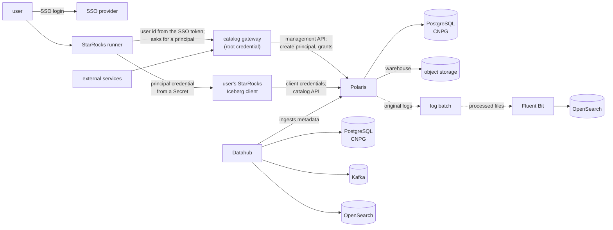

# Roadmap: publishing the lakehouse platform

- **Date:** 2026-10-10
- **Status:** plan. This is not a decision. Each item enters through its own ADR and PR
  (ADR-001); this file is updated when a phase starts or finishes.

## Scope

This repository builds, gates and releases the services in the first column. The services in
the second column belong to other teams. Here they are only interfaces, configured in `.env`
(ADR-002), with stand-ins on the gate cluster that are never released.

| Built and released here | Interfaces to other teams' services |
|---|---|
| **Apache Polaris** (ADR-009), with its own PostgreSQL on CloudNativePG (ADR-008, ADR-010) | **Object storage**, S3-compatible: the Iceberg warehouse and backups |
| **Polaris console** (`apache/polaris-tools` `console/`) | **Observability**: Fluent Bit, OpenSearch, Prometheus, Grafana |
| **The Polaris log batch** (ADR-014): processed log files ready for Fluent Bit | **ETL**: Spark, Flink, the shared Kafka |
| **Datahub**, with PostgreSQL on CNPG, a single-broker Kafka and a small OpenSearch, used by Datahub only (ADR-025) | **Query clients**: Trino, Iceberg clients, per-user StarRocks |
| | **SSO**: Keycloak |
| | **The catalog gateway**: Polaris's authorizer and wrapper API, built elsewhere |

Out of scope: each user's Spark cluster, because it calls neither Polaris nor Datahub.

## How callers reach Polaris and Datahub

- **Polaris issues its own tokens.** Each StarRocks Iceberg client authenticates to Polaris
  with its own principal's client ID and secret. Polaris RBAC on catalogs, namespaces and
  tables decides what it may do.
- **Principals are created by the catalog gateway**, which holds the root credential, when the
  StarRocks runner asks for one. The runner finds a user's credential by the user ID in their
  SSO token.
- **Exchanging an SSO token for a Polaris token is experimental** (P4). It is never on the
  release path until its ADR is Accepted.

## Phases

Each phase lists its ADRs, PRs, gate, and what only a Linux test cluster can verify
(issues whose Verification is "Needs Linux test cluster", ADR-073).

### P0: realign the decisions to this scope (ADRs only)

**Done:** ADR-023 (since superseded by ADR-031) to ADR-028, accepted by Kade on 2026-10-10.
Kade's choices: Datahub's PostgreSQL moves to CNPG now, its Kafka is the official image with
one broker, Polaris stays at 1.6.0, Polaris uses the OPA authorizer, and the console's image
source does not matter for operation. What follows is the list they cover.

- **Amend or supersede the ADRs written for a wider scope:**
  - ADR-007: namespaces only for what is built here; endpoints of other teams' services go in
    `.env`.
  - Object storage becomes an external S3 endpoint, with SeaweedFS only as the gate's
    stand-in (ADR-031).
  - The install order without storage and monitoring (restated in full by ADR-045).
  - Fluent Bit and OpenSearch belong to the observability team; this repository delivers the
    log files ADR-014 describes, in a documented format (ADR-024, ADR-081).
  - ADR-014: its open question (sharing the log volume across nodes) is answered before the
    batch is built.
  - ADR-017: the gate installs stand-ins (SeaweedFS, Fluent Bit) that are never released
    (ADR-031).
  - ADR-006: `init_env.py` drops the `minio-root` and `opensearch-admin` Secrets and gains
    Datahub's.
- **New ADRs:**
  - Datahub and its PostgreSQL, Kafka and OpenSearch;
  - the contract with other teams' services (S3, metrics, log files, SSO);
  - Polaris authentication and principal provisioning, as above;
  - network policies: which callers may reach which port;
  - the Polaris console: chart, and image source.
- **Gate:** static (ADR checker). Kade accepts each ADR.

### P1: the gates and the foundation

- The kind gate with dry-run and smoke workflows (ADR-017, ADR-050), gate-check (ADR-039),
  and the release flow, a candidate at a `main` commit promoted to a tag (ADR-080, ADR-051). The first release has nothing
  to upgrade from.
- The CloudNativePG operator on the gate and test clusters only, at the pinned version; on
  the target clusters it is the operator team's, and a release only checks it is present
  (first decided by Kade on 2026-10-10; ADR-045).
- gate-check first, before any platform file (done, PR #16); then ADR-030 (accepted), so
  auto-merge leaves PRs that change workflows or gate scripts, and drafts, to Kade
  ([#15](https://github.com/enjay27/lakehouse/issues/15)).
- The kind gate, before any chart: three nodes on `kindest/node:v1.36.4`, CNPG 1.30.1 from
  its pinned chart, `install/release.py` step 0, and a one-instance `Cluster` made Ready.
  First runs passed on commit `0d3092a` on 2026-10-10: dry-run
  [38060408982](https://github.com/enjay27/lakehouse/actions/runs/38060408982) (51 s), smoke
  [38060408746](https://github.com/enjay27/lakehouse/actions/runs/38060408746) (1 min 52 s,
  the `Cluster` Ready in 37 s).
- Branch cleanup (ADR-032, PR #24): its first run deleted the merged branch on 2026-10-10.
- The release flow (first through `rc`, accepted on 2026-10-10, replaced by ADR-080 on
  2026-10-23; Kade created the `platform-*` tag ruleset): the gates upgrade from the latest
  release the commit contains; since ADR-080 `candidate.yml` gates a `main` commit and tags it
  `-rc.N`, and `promote.yml` tags the same commit without a rebuild. Through `rc`, `release-gate.yml`
  gated a PR from `main` into `rc` and `release.yml` tagged the `rc` commit after reading that gate. Gates on commit `608bc73` (2026-10-10, no tag yet, so a
  fresh install): dry-run [38067420439](https://github.com/enjay27/lakehouse/actions/runs/38067420439),
  smoke [38067420520](https://github.com/enjay27/lakehouse/actions/runs/38067420520). The image
  cache waits for the first chart's images.
- **Gate:** static, then dry-run and smoke on kind. **Linux:** `init_env.py --apply-secrets`,
  verified on a Linux test cluster with Kubernetes v1.36.4 on 2026-10-16
  ([#6](https://github.com/enjay27/lakehouse/issues/6)).

### P2: Polaris 1.6.0 and its console

- The PostgreSQL `Cluster`, then the local Polaris chart (ADR-009). Settings are verified on
  the running object (ADR-016).
- `charts/polaris-postgres` (2026-10-10): the `Cluster` polaris-pg, three instances with
  required anti-affinity, installed by `install/release.py` step 1. The static gate renders
  it, checks its values schema and runs kubeconform (v0.8.0, pinned) on CNPG's CRD from the
  pinned chart, with PyYAML pinned by hash (Kade's choice). The gate's kind control-plane
  takes pods, so three nodes hold the instances apart; the smoke gate checks them on the
  running object instead of the one-instance scratch `Cluster`. Gates on commit `20190c2`
  (2026-10-10), both upgrading from `platform-2026.10.10`: dry-run
  [38073559912](https://github.com/enjay27/lakehouse/actions/runs/38073559912), smoke
  [38073559994](https://github.com/enjay27/lakehouse/actions/runs/38073559994) (the `Cluster`
  Ready in 1 min 32 s, three instances on three nodes).
- The stand-ins (2026-10-11, ADR-031): SeaweedFS 4.47 (`weed mini`, the bucket created at
  start) and OPA 1.21.0 with the gate's test policy `gates/opa/policy.rego`, in `NS_STANDINS`,
  installed by `gates/gate.py standins` before every gate install. The policy follows what
  Polaris 1.6.0 actually sends and reads, from its source: `docs/contracts/polaris-opa-input.md`
  (the URL names the package, the answer is `result.allow`). `release.py` now stops before
  Polaris unless the S3 and policy endpoints answer from Polaris's namespace (ADR-045); the
  smoke gate's `check-standins` makes an S3 round trip with Polaris's credentials and checks
  the policy's allowed and refused cases.
  Gates on commit `4f173d8` (2026-10-11), both upgrading from `platform-2026.10.10`: dry-run
  [38121760939](https://github.com/enjay27/lakehouse/actions/runs/38121760939), smoke
  [38121760980](https://github.com/enjay27/lakehouse/actions/runs/38121760980) (the stand-ins
  ready in seconds; the S3 round trip and all 7 policy cases, 3 allowed and 4 refused, ok).
- The recorder (2026-10-11, ADR-034, ADR-035): `gates/recorder/proxy.py`, Python standard
  library only, forwards every byte unchanged between Polaris's three connections and their
  services (OPA, SeaweedFS, polaris-pg; PostgreSQL TLS ends at the recorder, plain TCP to
  polaris-pg, since TLS on both sides fails SCRAM channel binding) and writes one JSON line per
  exchange, credentials and stored values left out. On the gate `.env` names it for
  `S3_ENDPOINT`, `POLARIS_OPA_URL` and the new `POLARIS_DB_HOST`. `check-standins` adds logins
  as Polaris with and without TLS through it; `check-traffic` matches the records against
  `gates/expectations/standins.json` (9 exchanges that must exist, 6 that must not). Polaris's
  own expectations come with its chart.
  Gates on commit `f30915a` (2026-10-11), both upgrading from `platform-2026.10.10`: dry-run
  [38123639581](https://github.com/enjay27/lakehouse/actions/runs/38123639581), smoke
  [38123641118](https://github.com/enjay27/lakehouse/actions/runs/38123641118) (logins as
  Polaris through the recorder with `sslmode=require` and `disable` ok, so polaris-pg accepts
  the recorder's plain TCP; 21 records, 13 HTTP and 8 PostgreSQL; all 15 expectations ok).
- Polaris 1.6.0 (2026-10-11, ADR-009, ADR-026): `charts/polaris` is upstream's chart from
  `apache-polaris-1.6.0`, unchanged but for trailing whitespace, without its `ci/` and
  `tests/`; our settings are in `values-lakehouse.yaml`: 2 replicas with required
  anti-affinity and a PodDisruptionBudget, `relational-jdbc` with `sslmode=require`, tokens
  signed with the shared symmetric key, the OPA authorizer (Kade's choices). `release.py` step
  1 then bootstraps the realm `POLARIS` with the admin tool (an already bootstrapped realm is
  kept) and installs Polaris. The smoke gate's `check-polaris` compares the running objects
  with the values and gets root a token both replicas accept; `polaris.json` holds the
  recorder to Polaris's own exchanges. Gates on commit `1683851` (2026-10-11), both upgrading
  from `platform-2026.10.10`: dry-run
  [38125705407](https://github.com/enjay27/lakehouse/actions/runs/38125705407), smoke
  [38125706002](https://github.com/enjay27/lakehouse/actions/runs/38125706002) (2 replicas on
  2 nodes; the token accepted by both pods; 142 records; all 21 expectations ok).
- A catalog on the S3 endpoint and the Iceberg REST smoke tests (2026-10-11, ADR-026,
  ADR-031): `gates/iceberg/smoke.py` runs PyIceberg 0.12.0 (Kade's choice: the target
  environments' Python clients use it; pinned by hash) as the principal gate_smoke. Root
  creates gate_catalog on S3 with `stsUnavailable` and no key in its properties; PyIceberg,
  with its own S3 key (Secret smoke-s3) and no vended credentials, creates a table, appends
  rows and reads them back; the policy refuses gate_smoke a drop and gate_other everything.
  Polaris writes table metadata with its own key, which reaches the AWS SDK through
  `extraEnv` (Kade's choice). What Polaris 1.6.0 does on S3 without STS, and why a key in a
  catalog's properties leaks into every table's metadata:
  `docs/contracts/polaris-s3-without-sts.md`. `iceberg.json` holds the recorder to the S3
  writes of each client and to the policy's answers. Passed on a1af23b: dry-run
  [38131673029](https://github.com/enjay27/lakehouse/actions/runs/38131673029), smoke
  [38131673239](https://github.com/enjay27/lakehouse/actions/runs/38131673239) (3 rows
  written and read back; the 3 refusals each a 403; 334 records; all 32 expectations ok).
- The console from `apache/polaris-tools` (2026-10-11, ADR-028): no image is published, so
  the smoke gate builds it from commit 3edb60f (`images/polaris-console`) with our lockfile
  (Kade's choice: npm packages released at least two weeks before, each checked by sha512;
  the UBI base images pinned by digest) and loads it into kind. `charts/polaris-console` is
  upstream's chart at that commit with our values. It is off by default
  (`POLARIS_CONSOLE_ENABLED`); when enabled, `release.py` installs it after Polaris (step 2,
  never blocking), and Polaris allows its origin (CORS) only then. `gate.py check-console`
  signs gate_maintainer in as the browser does (Kade's choice: over HTTP); the gate's policy
  lets it read only. Passed on 79814d6: dry-run
  [38133756210](https://github.com/enjay27/lakehouse/actions/runs/38133756210), smoke
  [38133756150](https://github.com/enjay27/lakehouse/actions/runs/38133756150) (the image
  built and loaded; the 10 sign-in checks ok; console.json's 3 expectations and the other 32
  ok). Open: how the image reaches a target cluster (ADR-028).
- The log batch (2026-10-11, ADR-014, ADR-024, ADR-036, ADR-081, ADR-037, #45). Polaris writes one
  JSON file per pod to the `ReadWriteMany` claim `polaris-logs`, which `release.py` step 1
  creates before Polaris; step 2 installs the batch's CronJob before the console, and its
  failure stops the install. Smoke [38143901431](https://github.com/enjay27/lakehouse/actions/runs/38143901431)
  and dry-run [38143901179](https://github.com/enjay27/lakehouse/actions/runs/38143901179)
  passed on `976eeb4` (#51). Its output is contract v2 (`docs/contracts/polaris-logs.md`):
  the archive's audit policy keeps refusals, errors and changes and counts the rest in
  resource, principal and app_dropped rows; its kept lines and counters match the Fluent Bit
  Lua filter it came from (the archive's step16, six seeds, 2026-10-11). The smoke gate's
  `check-logs` sends each Polaris pod reads with root's token and requests without one, runs
  the batch twice with its clock past that hour, and a stand-in Fluent Bit 5.1.2 reads the
  output from the claim, read-only: every line and row holds contract v2, every summary's
  books balance, each refused request is kept once from its pod, no read is kept but the rows
  count them, both pods' files are read, and the second run changes nothing.
  The release flow pushes the batch's image to GHCR under its content-hash tag, and a
  cluster pulls it from `IMAGE_REGISTRY` or GHCR (ADR-080, #55); `platform-2026.10.12`,
  the first release with Polaris, pushed it (#78).
- Backups (2026-10-12, ADR-043, #83). polaris-pg archives its WAL and takes a daily base
  backup through the Barman Cloud Plugin into `POLARIS_BACKUP_BUCKET`, with its own key in
  `polaris-backup-s3`; step 0 requires the plugin and its `ObjectStore` CRD. The gate
  installs cert-manager and the plugin from pinned manifests, and the smoke gate's
  `check-restore` backs polaris-pg up, restores it into `polaris-pg-restore` and reads the
  root principal and the smoke tests' catalog from it. The restore runbook,
  `docs/runbooks/restore-polaris-pg.md`, was proven on a Linux test cluster on 2026-10-16
  ([#138](https://github.com/enjay27/lakehouse/issues/138)); its three gaps were closed in
  [#169](https://github.com/enjay27/lakehouse/pull/169).
- Network policies (2026-10-13, ADR-048, ADR-045, #93). `charts/polaris-network-policies`
  denies ingress to Polaris's namespace by default and allows each rule of ADR-048 by
  namespace label from `.env`; step 1 installs it first, after labelling Polaris's running
  pods as polaris-pg's clients. The stand-ins' namespace denies by default too. The smoke
  gate's `check-network` makes one allowed and one refused connection per rule. The target
  clusters' labels are a question for the operator team (#9). On a Linux test cluster with
  no recorder in between, the first upgrade to a release with them (10.12 → 10.14) kept the
  old Polaris pods' connections to polaris-pg on 2026-10-16
  ([#95](https://github.com/enjay27/lakehouse/issues/95)).
- Polaris's metrics (2026-10-13, ADR-046, #98): P5's Polaris half, built ahead of Datahub.
  Polaris on 8182 and polaris-pg's instances on 9187 are a scrape contract in
  `docs/contracts/`; a release ships no `ServiceMonitor`. The smoke gate's Prometheus
  stand-in loads the contract's scrape file and `check-metrics` requires every pod up and
  the contract's series.
- Before Datahub (Kade, 2026-10-12): failover (#31). ADR-047 measures it first:
  `failover.yml` on `gate/failover/<task>` runs the CNPG setups C0 to C2 under S1 to S3 with
  a pgjdbc probe (`gates/failover/`). C3a, C3b and C4 wait on the target's PG-HA and Pgpool
  versions (#31); results are committed once C3a reproduces the target. Tuning follows
  (ADR-047 §8): first `smartShutdownTimeout: 0` in `charts/polaris-postgres`, for C0's
  ~185 s outage when the primary pod is deleted; then synchronous replication (ADR-056), for
  the confirmed writes C0 lost on a node loss; then pgjdbc's connect, login and socket
  timeouts in Polaris's values (#165), so a pooled connection no longer waits out a node loss.
  An upgrade that changes polaris-pg's spec restarts its primary in place, CNPG's default
  `primaryUpdateMethod`: about 18 s of failed requests on 10.12 → 10.14, measured on a Linux
  test cluster; switchover or restart is Kade's decision
  ([#168](https://github.com/enjay27/lakehouse/issues/168)).
  Kade parked failover on 2026-10-16, to come back to. CNPG's readiness probe at 1 s, measured
  the same day, did not shorten an outage and was not merged (#31). Datahub starts before it
  (Kade, 2026-10-18).
- **Gate:** dry-run and smoke. **Linux:** the release installed on a test cluster: done on
  2026-10-16, on a three-node kind cluster on Linux built by the gate's own scripts
  (ADR-004), with #95's upgrade and #138's restore above.

### P3: Datahub

Started on 2026-10-18 (Kade).

- Datahub's PostgreSQL (ADR-066): `charts/datahub-postgres`, copied from Polaris's, the
  `Cluster` datahub-pg with three asynchronous instances, backing up to its own bucket
  (`DATAHUB_BACKUP_BUCKET`) with its own key (`datahub-backup-s3`);
  `charts/datahub-network-policies`, default deny in Datahub's namespace with datahub-pg's
  rules; installed after Polaris in step 1. The smoke gate's `check-datahub-pg` checks it is
  asynchronous, archives its WAL and completes a backup.
- Datahub's Kafka (ADR-068, ADR-069): `charts/datahub-kafka`, one KRaft broker from
  `apache/kafka` 4.3.1, broker and controller in one process, its controller the static voter
  `1@localhost:9093`; plaintext on 9092 for pods labelled `lakehouse/datahub-kafka-client`;
  installed after datahub-pg in step 1. The smoke gate's `check-datahub-kafka` round-trips a
  4.5 MiB message across a restart of the broker's pod. The recovery of Datahub's topics after
  the broker's volume is lost is proven with Datahub's chart (ADR-025).
- Datahub's OpenSearch (ADR-070): `charts/datahub-opensearch`, upstream's opensearch chart
  2.38.0 unchanged with our `values-lakehouse.yaml`, one node of
  `opensearchproject/opensearch` 2.19.6 with its security plugin off, no root or privileged
  container; plain HTTP on 9200 for pods labelled `lakehouse/datahub-opensearch-client`;
  installed after datahub-kafka in step 1. The smoke gate's `check-datahub-opensearch`
  writes a document over plain HTTP and finds it again after a restart of the node's pod.
  The Linux test server's `vm.max_map_count` is read before the check is first proven there.
- Datahub itself (ADR-071, ADR-072): `charts/datahub`, upstream's datahub chart 1.1.7, its
  release archive with one patched line so GMS runs by digest, and our
  `values-lakehouse.yaml`: Datahub `v1.7.0.1`, one GMS with its consumers, the frontend, the
  system-update Jobs and a suspended restore-indices template, on its three stores with no
  index replica; every pod a client of the three stores and of GMS; the six credentials from
  `init_env.py` in four Secrets, none from the chart; GMS open to its clients and the emitters'
  namespaces (`DATAHUB_EMITTER_NAMESPACE_LABEL`), the frontend to the ingress namespace;
  installed after datahub-opensearch in step 1. The smoke gate's `check-datahub` writes a
  dataset, reads it back and finds it by search, and signs the root user in;
  `check-datahub-recovery` loses OpenSearch's volume, then Kafka's: Datahub's install step and a
  restore-indices Job rebuild the indices, the install step recreates the topics, and a dataset
  written before both is still read and found (ADR-071 §8).
- Datahub ingests Polaris's catalogs (ADR-076): upstream's ingestion CronJob in
  `charts/datahub`, the full `acryldata/datahub-ingestion` image by digest, daily, one
  ingestion per catalog of `DATAHUB_INGEST_POLARIS_CATALOGS` with stateful ingestion, suspended
  while the list is empty; as the principal `datahub_ingest`, which the install creates as root
  with init-env's credential (`datahub-polaris-principal`) and the policy lets only read
  (`docs/contracts/datahub-polaris-ingestion.md`); GMS's system client as the sink. The smoke
  gate's `check-datahub-ingestion` seeds a catalog, runs one ingestion from the CronJob, finds
  its datasets, fields and container in Datahub, and sees the principal refused a write and a
  delegated load. Requests and a memory limit for the CronJob come from the gate's runs.
- Its own login through SSO, against a stand-in on the gate.
- A runbook, proven on a Linux test cluster, moves Datahub's metadata from the target
  clusters' existing PostgreSQL-HA to the new `Cluster`.
- **Gate:** dry-run and smoke, including one ingestion run.

### P4: callers and their contracts

- One contract test per caller class against the gate's Polaris and Datahub. They use the
  caller's protocol and a principal like the one it uses in production. Classes:
  - the catalog gateway: the management API;
  - StarRocks' Iceberg client: the catalog API, one principal per user;
  - PyIceberg, the Python clients' library (the smoke tests already use 0.12.0);
  - Trino, through its Iceberg REST catalog connector;
  - Spark and Flink ETL jobs writing Iceberg tables;
  - a Kafka Connect Iceberg sink on the ETL Kafka;
  - table maintenance jobs (compaction, snapshot expiry, orphan-file cleanup);
  - Prometheus, scraping Polaris's management port and Datahub's metrics;
  - Datahub's callers: Spark and Flink lineage, an orchestrator that emits lineage or runs
    ingestion, data-quality and BI tools reading its API, and SSO for its login.
- Datahub ingests from Polaris only (Kade, [#10](https://github.com/enjay27/lakehouse/issues/10)).
  Notebooks do not call Polaris.
- Network policies from P0's ADR.
- The experimental token exchange (an SSO token for a Polaris token for the same principal):
  a spike behind its own ADR, never on the release path.

### P5: hooks for the observability team

- Metrics endpoints and the scrape configuration the other team's Prometheus needs:
  Polaris's done in P2 (ADR-046); Datahub's join the contract with its chart.
- Log files and their format as P0 documents them. No dashboards of our own.

### P6: measurements

- The suite (ADR-005) measures Polaris catalog latency and throughput on the plain upstream
  schema (ADR-015). Results go to `docs/measurements/`, with the versions measured (ADR-003).
- The stress test (ADR-053, amended by ADR-054;
  [#142](https://github.com/enjay27/lakehouse/issues/142)): k6 at one rate per step
  against 100 seeded tables of about 1 MB metadata each, toward 12,000 req/s (1.5× today's
  peak). Tier A runs on the gate's kind only when Kade starts it (`stress.yml`), never in the
  release gate. Step 1a merged in
  [#145](https://github.com/enjay27/lakehouse/pull/145); PR 1b, the driver, seed,
  scenario and `stress.yml`, merged in
  [#170](https://github.com/enjay27/lakehouse/pull/170)
  ([#148](https://github.com/enjay27/lakehouse/issues/148)). Its seed ran on a Linux test
  cluster on 2026-10-16: Polaris 1.6.0 accepts the reused manifest list.
- Tier D (ADR-053 §7): one Polaris replica's capacity on the Linux test server, by hand from
  `docs/runbooks/stress-capacity.md`, measured on 2026-10-16
  ([#174](https://github.com/enjay27/lakehouse/issues/174)):
  `docs/measurements/stress-capacity-2026-10-16.md`. With 4 CPUs and 8 GiB, the knees were
  40 commits/s, 125 req/s of conditional and of full loads, and 25 req/s of the mixed profile.
  The read and mixed knees were set by the upstream image's Parallel collector, whose full
  collections paused up to 0.4 s, while Polaris used under half its CPU. The 2-hour hold at 20
  req/s answered all 209,149 requests with no heap growth. The sizing for 12,000 req/s waits on
  that collector's tuning.
- Polaris's collector (ADR-061, amended by ADR-062 and ADR-063;
  [#182](https://github.com/enjay27/lakehouse/issues/182)): Polaris runs generational ZGC at a
  50% heap share, measured by Tier D on 2026-10-17
  ([#184](https://github.com/enjay27/lakehouse/pull/184)):
  `docs/measurements/stress-capacity-2026-10-17.md`.
  - The knees rose to 45 commits/s, 250 and 275 req/s of conditional and full loads, and
    75 req/s of the mixed profile.
  - The 2-hour hold at 60 req/s answered all 511,102 requests, its longest pause 1 ms.
  - The sizing for 12,000 req/s: 160 Polaris replicas and 9.3 cores for polaris-pg's
    primary, estimates to check against #9's answers.
  - A first attempt at a 70% share was killed by Polaris's memory limit.
- ZGC's allocation stalls ([#186](https://github.com/enjay27/lakehouse/issues/186),
  [#187](https://github.com/enjay27/lakehouse/pull/187)): a mixed-only run with ZGC's log,
  `docs/measurements/stress-capacity-2026-10-17-mixed-gc.md`. At a 4 GiB heap, ZGC stalled
  allocation in the first seconds of each step only. On fresh tables, both ramps' knee was
  150 req/s. Open:
  - [#188](https://github.com/enjay27/lakehouse/issues/188): whether the knee is set by a
    step's sudden start;
  - [#189](https://github.com/enjay27/lakehouse/issues/189): whether the lower knee came from
    tables grown by the earlier profiles;
  - [#190](https://github.com/enjay27/lakehouse/issues/190): what the heap share does to the
    stalls.
- An overloaded Polaris is restarted by the upstream chart's liveness probe
  ([#179](https://github.com/enjay27/lakehouse/issues/179)): seen in Tier D on 2026-10-16,
  open for a decision.

### P7: first release, then upgrades

- The first release with Polaris and Datahub, a candidate at a `main` commit, then `platform-YYYY.MM.DD`
  (ADR-080), with release notes and runbooks for installing and upgrading.
- The Polaris 1.7.0 upgrade as its own PR (ADR-009), gated from the last release (ADR-051).

## Pinned versions

Chosen on 2026-10-10 ([#9](https://github.com/enjay27/lakehouse/issues/9)). Each value moves
into its chart's values when the chart enters; a pin whose source is "target unknown" moves
when Kade learns the target clusters' version.

| Item | Pin | Source |
|---|---|---|
| Kubernetes (gate, kind) | 1.36 (`kindest/node:v1.36.4`) | Kade: latest stable; 1.37 exists, but CloudNativePG 1.30 supports 1.34–1.36 |
| CloudNativePG operator (gate only, ADR-045) | 1.30.1 | latest; target unknown |
| cert-manager (gate only, ADR-043) | v1.21.2 | newest at least two weeks old; target unknown |
| Barman Cloud Plugin (gate only, ADR-043) | v0.15.1 | newest at least two weeks old (released 2026-09-30); target unknown |
| Polaris | 1.6.0 | Kade (ADR-009) |
| PostgreSQL for Polaris | 16 (CNPG image 16.15, by digest in `charts/polaris-postgres`), 3 instances, required anti-affinity | Kade |
| Pooler for Polaris | none | open: Kade does not know (ADR-010) |
| Datahub | v1.7.0.1 (chart 1.1.7, by digest in `charts/datahub`) | Kade (ADR-071) |
| PostgreSQL for Datahub | 16 | same as Polaris; target unknown |
| Kafka (`apache/kafka`) | 4.3.1 | latest stable; target unknown |
| OpenSearch (Datahub) | 2.19.6 | latest 2.x, the line Datahub's chart uses; target unknown |
| CPU architecture | `x86_64` | assumed (ADR-017); open |

## Risks to verify

- **Bitnami images: confirmed, and resolved by ADR-025.** Checked on 2026-10-10 in the
  upstream repositories: since 2025-08-28, `postgresql-repmgr`, `pgpool` and `kafka` are
  available only to paying customers; old tags are frozen in `bitnamilegacy`. Datahub's
  prerequisites chart still uses them, so it is not used here.
- **Root credential concentration: accepted in ADR-026.** Polaris's REST API cannot grant
  anything between root and full `service_admin`, so the gateway creates principals with root;
  narrower rules live in the gateway's own policy.
- **Three levels of `workflow_run`.** Static → Auto-merge → Labels is GitHub's limit, so a new
  workflow cannot chain after Labels.

## Open items

- [#9](https://github.com/enjay27/lakehouse/issues/9): versions pinned above; the pooler and the
  CPU architecture are still open (Kade).
- [#179](https://github.com/enjay27/lakehouse/issues/179): an overloaded Polaris is killed by its
  liveness probe; keep the probe, loosen it, or size so Polaris never saturates.
- [#168](https://github.com/enjay27/lakehouse/issues/168): an upgrade that changes polaris-pg's spec
  restarts its primary in place; switchover or restart (Kade).
